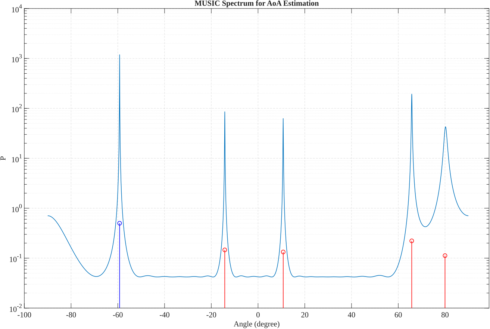
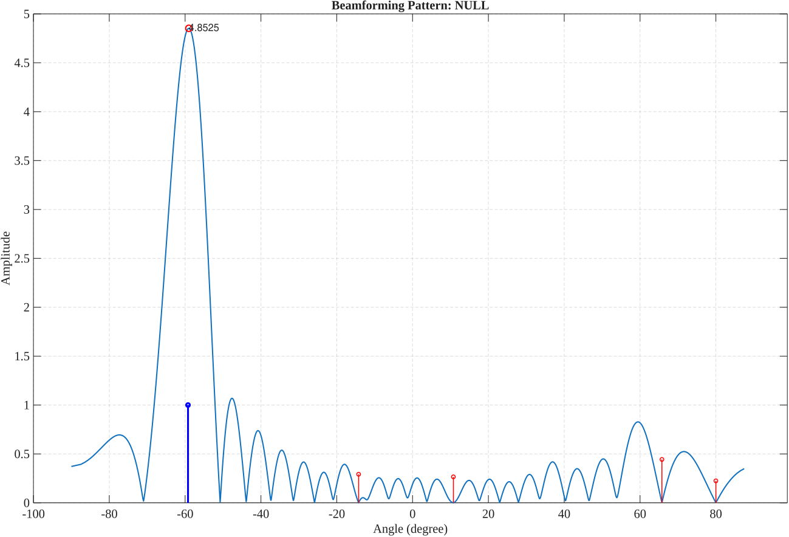
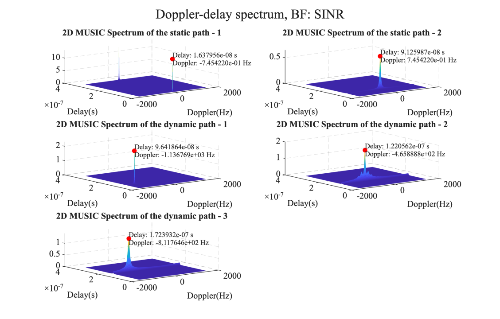

[](https://opensource.org/licenses/MIT) [](https://www.mathworks.com/) [](https://arxiv.org/abs/2503.10107)

## 简介

本仓库提供论文 ["High-Resolution Uplink Sensing in Millimeter-Wave ISAC Systems"](https://arxiv.org/abs/2503.10107) 中算法的演示实现。代码仿真了一个基于毫米波混合阵列的上行感知框架，用于高精度目标参数估计。


仿真生成一个包含 $L_s$ 个静态目标和 $L_d$ 个动态目标的场景，各目标具有不同的距离、速度和到达角（AoA）。系统首先进行高分辨率到达角估计，再使用基于到达角的二维 FFT-MUSIC（AB2FM）算法估计目标参数。

本实现包含以下主要功能：
1. 采用基于频域平滑的 MUSIC 算法进行**高分辨率到达角估计**。
2. **视距（LoS）路径检测**。
3. **多种波束形成策略**，包括 Bartlett 波束形成器、零空间方法、SINR 优化方法和混合方法。
4. 使用**基于到达角的二维 FFT-MUSIC（AB2FM）算法**进行多普勒—时延联合估计，精确恢复目标的角度、距离和速度等参数。

本实现支持灵活配置系统参数与场景复杂度。

## 参数设置

基本参数在 `Main.m` 中定义：
```matlab
Ls            = 2;              % Number of static paths
Ld            = 3;              % Number of dynamic paths
L             = Ld + Ls;        % Total number of paths
EbN0_dB       = 10;             % Signal to noise ratio in dB
BF_type       = 'SINR';         % Beamforming type: 'SINR', 'NULL', 'BART', 'HYBD'
```

高级参数在 `Params.m` 中定义：
```matlab
Nr       = 24;     % Number of antennas
Snap_AoA = 50;     % Number of snapshots for Angle of Arrival estimation
Snap_DD  = 10;     % Number of snapshots for Doppler-delay estimation
K        = 32;     % Number of subcarriers
M        = 32;     % Length of each frame (symbols per frame)
Tm       = 1024;   % Interval between two frames (in samples)
fc       = 26e9;   % Carrier frequency, 26 GHz (mmWave band)
D_f      = 100e6 / K;  % Subcarrier spacing (Hz)
Ts       = 1 / D_f;    % Sampling interval (s), equal to symbol duration
c        = 3e8;    % Speed of light (m/s)
```

注意，`L` 应小于 `Nr` 和 `K/2`。

## 结果可视化

### 用于到达角估计的 MUSIC 谱


### 波束方向图


### 用于多普勒—时延估计的二维 MUSIC 谱


## 引用

如果在研究中使用这些代码，请引用我们的论文：

```bibtex
@ARTICLE{Zhao2025HighResolution,
  author={Zhao, Liangbin and Ni, Zhitong and Feng, Yimeng and Li, Jianguo and Bu, Xiangyuan and Andrew Zhang, J.},
  journal={IEEE Transactions on Communications}, 
  title={High-Resolution Uplink Sensing in Millimeter-Wave ISAC Systems}, 
  year={2025},
  volume={73},
  number={11},
  pages={12680-12695},
  doi={10.1109/TCOMM.2025.3585582}}
```

