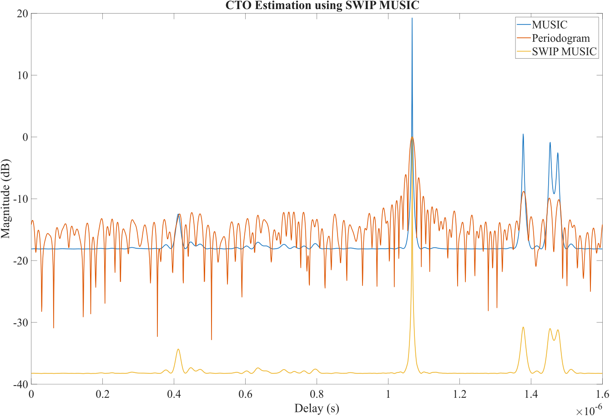
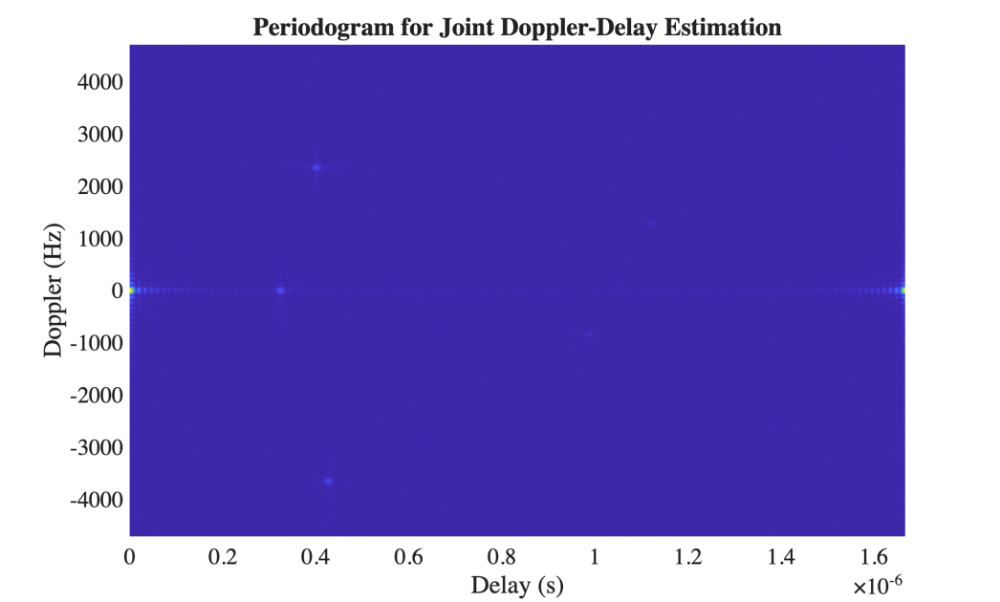

[](https://opensource.org/licenses/MIT) [](https://www.mathworks.com/) [](https://vtc2025-spring.ieee-vtc.org/)

## 简介

本仓库提供 VTC 2025 接收论文 **"Passive Sensing for Multiple Vehicles in Bi-static ISAC Systems"** 中算法的演示实现。代码仿真了一个双基地通信感知一体化（ISAC）系统，用于多车辆被动感知。

本实现包含以下主要功能：
1. 使用 **FBS（前后向平滑）算法**进行快拍扩增。
2. **SWIP-MUSIC 算法**结合周期图与 MUSIC 方法，实现稳健的时偏估计。
3. 采用基于周期图的算法进行**多普勒—时延联合估计**，恢复车辆参数。
4. 对估计结果与算法性能进行**完整可视化**。


## 快速开始

运行 `main.m` 即可开始仿真。

所有参数均在 `params.m` 中配置，运行时会自动加载。

## 仓库结构

```txt
├── main.m                      % Main simulation script
├── params.m                    % System parameters configuration
├── Funcs/                      % Algorithm implementations
│   ├── Gen_delays_with_gap.m   % Generate delays with minimum separation
│   ├── Gen_received_signal.m   % Signal generation with TO/CFO
│   ├── SWIP_MUSIC.m           % SWIP-MUSIC algorithm implementation
│   └── Periodogram_DD.m       % Joint Doppler-delay estimation
├── Presentation-Latex/         % Conference presentation materials
│   ├── VTC-2025-Liangbin.tex  % LaTeX source
│   ├── VTC-2025-Liangbin.pdf  % Compiled presentation
│   └── figures/               % Presentation figures
└── README.md                   % This file
```

## 仿真结果





## 会议演示材料

我们还在 `Presentation-Latex/` 目录中开源了会议演示材料。演示文稿基于开源的 [mtheme](https://github.com/matze/mtheme) 模板制作，感谢模板开发者的工作。我们对原主题做了一些调整，并将定制版本分享出来，方便需要制作类似演示文稿的读者参考。

演示文稿采用 [Nord theme](https://www.nordtheme.com/) 配色，以获得舒适的视觉效果。

**编译顺序**：`xelatex -> xelatex`

如果这些内容对你有帮助，欢迎在 GitHub 上点一颗 Star ⭐！

## 致谢

- 会议演示模板：[mtheme](https://github.com/matze/mtheme)
- 配色参考：[Nord theme](https://www.nordtheme.com/)

## 引用

如果在研究中使用这些代码，请引用我们的论文：

```bibtex
@INPROCEEDINGS{Zhao2025PassiveSensing,
  author={Zhao, Liangbin and Feng, Yimeng and Ni, Zhitong and Bu, Xiangyuan},
  booktitle={2025 IEEE 101st Vehicular Technology Conference (VTC2025-Spring)}, 
  title={Passive Sensing for Multiple Vehicles in Bi-Static ISAC Systems}, 
  year={2025},
  volume={},
  number={},
  pages={1-6},
  doi={10.1109/VTC2025-Spring65109.2025.11174283}}
```

## 许可证

代码与使用说明请查看[项目仓库](https://github.com/zhaoliangbin42/VTC2025-SWIP-MUSIC)。引用研究结果时，请同时引用论文。

---

**说明**：如果在研究中使用我们的代码或算法，请引用论文，并注明本仓库。
