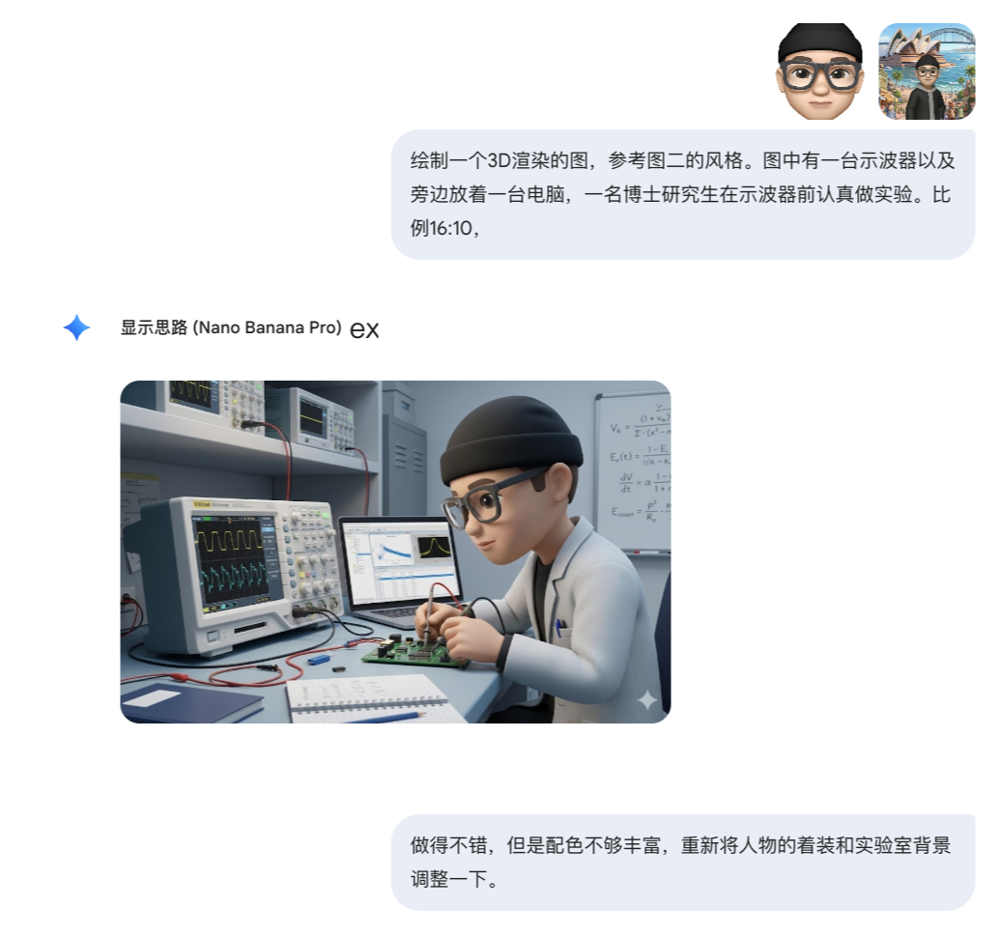

## Homepage

### A portrait scene at the Sydney Opera House

Version: Google Gemini 3 Nano Banana Pro

> Do not replace the face. Make it slightly cartoon-like while maintaining a very high degree of consistency. Preserve the person's facial likeness throughout, with the body turned slightly inward. Use a distant third-person camera angle and a typical Japanese/Korean-style selfie aesthetic. Keep the composition clean and simple so that the person stands out. The whole image should be clear, with a polished, fashionable look and a slight group-photo feel. Blend the person seamlessly into the scene, with natural visual transitions and bright, even lighting. Place the person in a Zootopia-style 3D animal city, with the Sydney Opera House and Sydney Harbour Bridge behind me. Retain the person from the original image, but transform the surroundings into stylized anthropomorphic infrastructure. 8K quality, 1:1 aspect ratio.

### Working in a laboratory

Version: Google Gemini 3 Nano Banana Pro

> Create a 3D-rendered image in the style of the second reference image. Show an oscilloscope with a computer beside it, and a doctoral student carefully conducting an experiment in front of the oscilloscope. Aspect ratio: 16:10.

## Notes page

Version: Google Gemini 3 Nano Banana Pro

The prompt for this page's icon:

> A minimalist 3D render of the logos of OpenAI and Google Gemini, floating directly in the center against the background. The object features a smooth matte plastic texture and is rendered in **beautiful, aesthetically pleasing colors suitable for high-end design**. It is **small scale, appearing tiny relative to the vast frame, leaving enormous amounts of negative space around it**. Soft diffused studio lighting. The background is a luxurious abstract fluid gradient, shades of **[cyan, soft blue, and purple]**, blurred, elegant, tech vibe. ultra-detailed, 8k resolution --ar 1:1 --no background card, platform, podium

## Code page

Version: Google Gemini 3 Nano Banana Pro

The prompt for the code page's icon:

> A miniature three-dimensional model of communication equipment. The scene is a highway with greenery along both sides and a base station on each side, both transmitting signals. Several small cars are driving on the highway, with speed-camera signs along the road. Make it rather cute. Handmade polymer-clay styling, studio macro photography, soft lighting, shallow depth of field, 16:10 aspect ratio.

## Recommended project

Here is an open-source project from which I borrowed some inspiration:

[Awesome-Nano-Banana-images](https://github.com/PicoTrex/Awesome-Nano-Banana-images)
