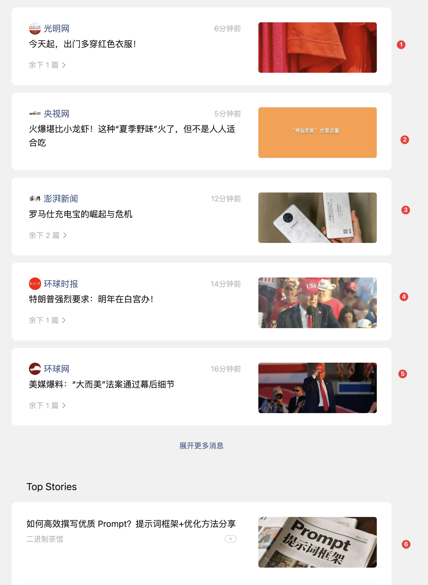
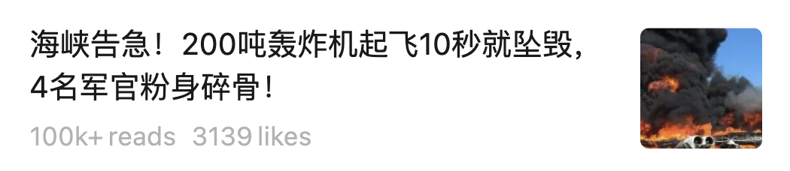
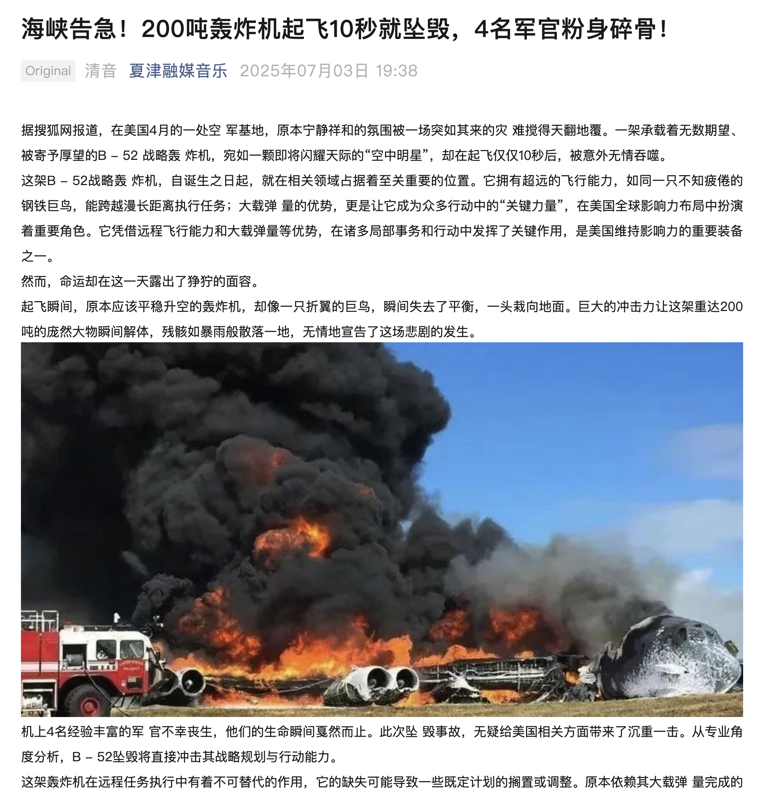
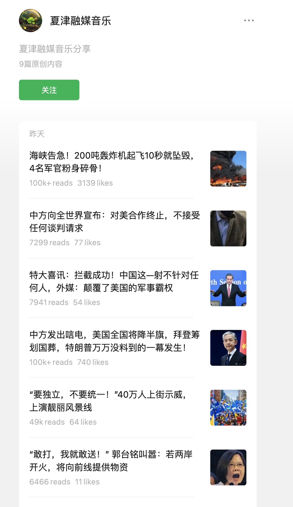
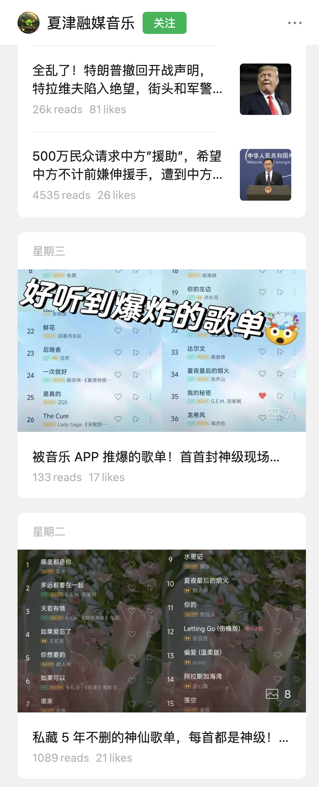

Recently, I saw an article from the WeChat Official Account "Xiuming's Notes" titled "WeChat Official Accounts Are Dead!!!" It was an eye-catching headline. Its central argument was: "WeChat Official Accounts are dead! In pursuit of traffic, the WeChat team has clumsily copied others and turned Official Accounts into another Toutiao, losing what made them distinctive. Their decline is inevitable. There is no longer any point in running an account like this."

I do not particularly like articles that express their emotions so bluntly. Nevertheless, I have also noticed that recent changes to the Official Accounts feed seem to be bringing it closer to Toutiao. Headlines and traffic are taking precedence over the content itself; bad content is driving out good content. It is disappointing. From my own perspective, I agree with the author's point.

One very noticeable change is that the accounts I used to follow, especially those that publish less frequently or whose posts I open less often, appear in front of me less and less. They are being replaced by accounts I have never followed. Their content may relate to my interests, but I do not want WeChat to push it at me. I would rather search for it when I need it. Yet it is occupying an increasingly prominent part of the feed.

Repeated WeChat updates have also substantially changed the account list. At first, I could see all the accounts I followed in a straightforward list. Later, their avatars became a horizontal strip at the top. Now even the entrance to the account list is buried two or three levels deep. I follow more than a hundred accounts, but only a dozen or twenty seem to reach me each day.

> The Official Accounts page in my desktop WeChat. Only the first five posts in the default view come from accounts I follow. Everything from Top Stories onward is recommended by the algorithm. Often, only the headlines match my interests; the content itself has little depth.

I have long had a habit of browsing WeChat posts. Unlike friends who prefer information-dense platforms such as Zhihu, I tend to get my high-value, concentrated information through WeChat Official Accounts. I also follow news accounts such as CCTV News and Xinhua to make up for the current affairs I miss by not using news apps. As a result, WeChat posts are almost my only source of information. On reflection, that really is the case: I do not browse Xiaohongshu, Zhihu, or news apps. In my spare time, I browse WeChat and Bilibili, but Bilibili is mostly for entertainment, leaving WeChat as almost my only information source.

I used to believe that the old subscription-based delivery system gave authors a reason to produce high-quality content with depth and breadth. Official Accounts also offered a tipping feature that could make a meaningful contribution to an author's income, further encouraging good writing.

Around 2016, while I was an undergraduate, I started my own Official Account out of interest. Looking back, I spent a fair amount of time thinking about how to write something interesting and thoughtful. Comments and likes made me happy, and there were regular readers who connected with the writing and joined in the thinking and discussion. Although I eventually stopped, I believe that, in that setting, I had a reason as an account author to produce reasonably high-quality work.

My idea of "that setting" is a little vague, but I do have a rough framework in mind:

1. Existing readers should receive an author's articles promptly, read them, and discuss them in a timely way.
2. Clickbait with little worthwhile content should be given less weight, so that it does not prosper simply by gaming attention.
3. There should be suitable ways for authors to earn money.
4. The overall creative environment should be healthy enough for readers to respect the platform. Mentioning WeChat Official Accounts should not immediately invite comparisons with platforms people avoid, such as Baijiahao or the sensational "You Won't Believe" style associated with UC headlines.

Of course, I am not a WeChat product manager, and I have not written for an Official Account in a long time. My ideas may be too idealistic and too simple. But as a reader, I feel the content WeChat now pushes toward me is increasingly sensational, eager to please, and designed to reduce the amount of thinking I do. The longstanding strength of Official Accounts has been the quality of the articles. If that quality falls sharply and traffic matters more than content, what distinguishes the platform from Toutiao or Baijiahao? I sincerely hope the WeChat team can find a good approach that maintains the earlier quality of its articles and improves both the reading experience and the depth of readers' engagement.

There is another point. Given the rapid development of AI and how I imagine it progressing, I think Tencent Hunyuan's ability to retrieve Official Account content and answer questions after integrating DeepSeek is itself a competitive advantage. Much of the content online is unreliable. If a retrieved passage comes from a WeChat Official Account, and opening it reveals the work of a well-known author, it naturally carries more credibility. Users will then have more trust in Hunyuan's output. Over the long term, that should benefit Tencent as a whole.

P.S. I wrote this because I recently encountered a piece of clickbait in the Top Stories feed that I could not let pass without comment. Reading it made me laugh out of frustration and feel sorry for people who put real effort into their writing. Someone else can think up two catchy headlines and easily get over 100,000 views. How would that make you feel?

This post had over 100,000 views. Opening it revealed:

What a fine primary-school composition. Such accomplished use of metaphor—which language model wrote it? Wait, this account is called "Xiajin Integrated Media Music"? Shouldn't it be discussing music? Why is it posting news? Let's open the account.

Good grief, it is all news. Several posts have tens of thousands of views. Despite the word "music" in the name, perhaps this account usually posts news and has plenty of followers? Wait—only nine original posts? Is it really that easy to get over 100,000 views? Let's see what the earlier posts were like.

The previous post had 133 views...

WeChat, please put some thought into Official Accounts. Letting bad content drive out good content like this will eventually come back to hurt you.
