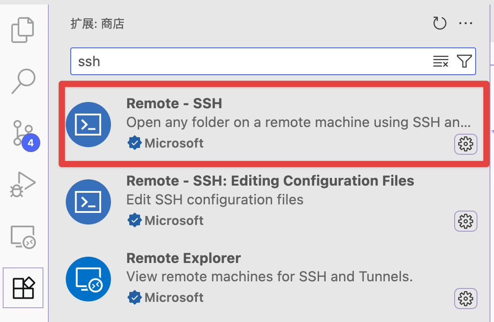
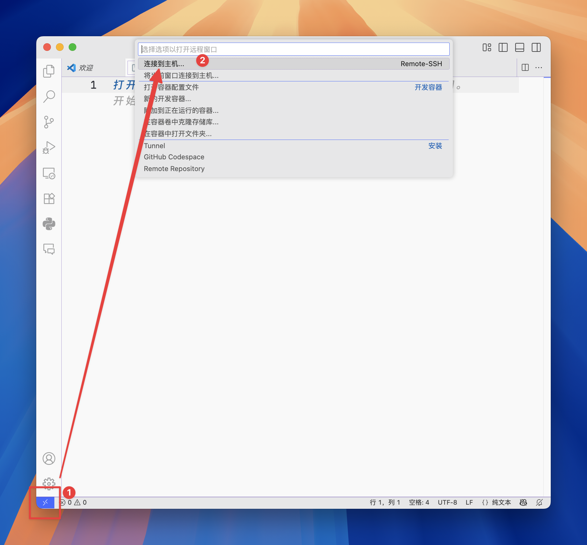
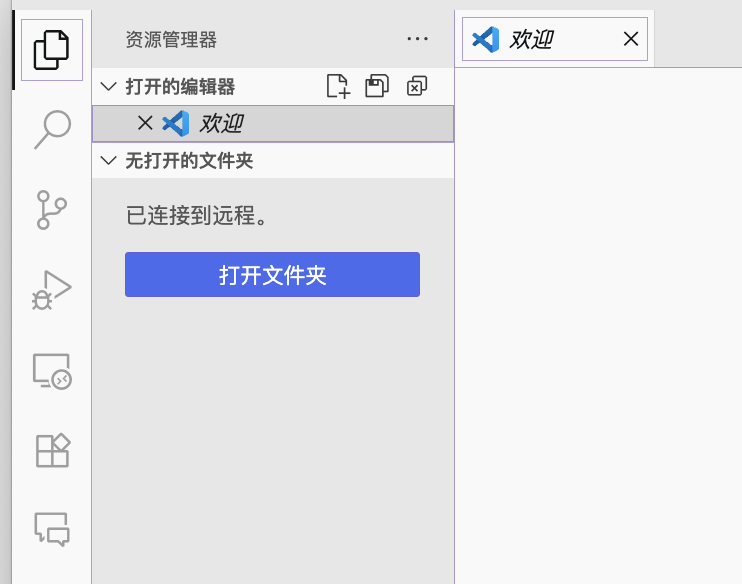
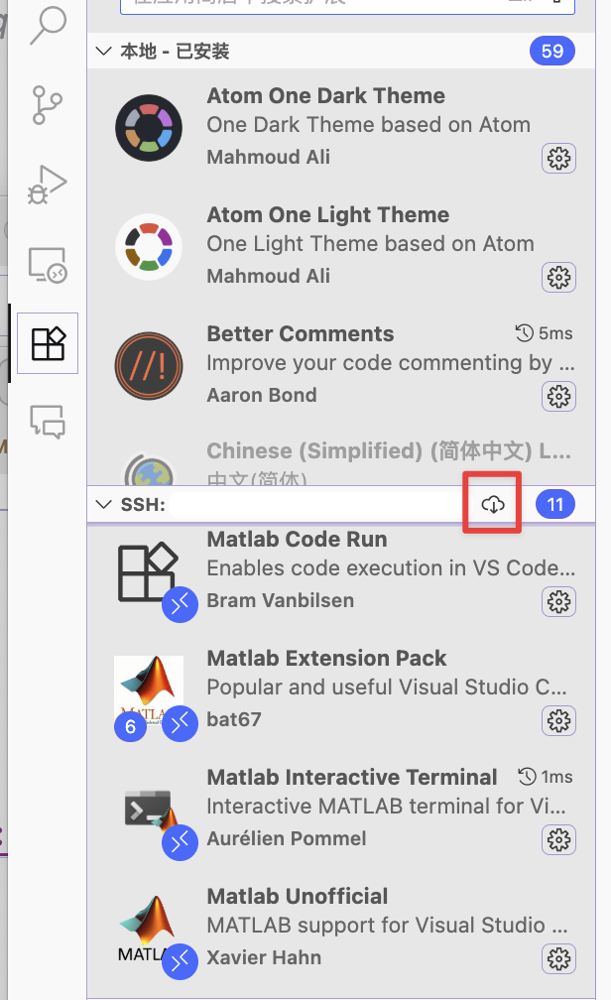
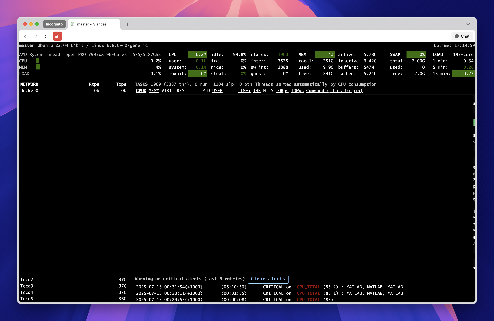
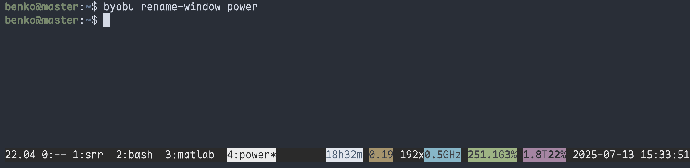

## Background

Most of us probably use Windows or macOS day to day and have fewer opportunities to work with Linux systems such as Ubuntu. However, **the vast majority of servers actually run Linux**.

In my own experience with Vivado, compilation on Linux has been as much as five times faster than on Windows with the same hardware. A very large project that took thirty hours to compile on Windows could finish in under six hours on Linux. MATLAB computations also run more efficiently on Linux with the same hardware, especially when using parallel processing.

For that reason, when our research group later set up servers, I recommended installing Linux first. It is a little harder to learn initially, but the subsequent efficiency gains more than repay the time spent figuring things out.

This article does not cover graphical interfaces. In many situations, a graphical remote connection is unstable and unpleasant to use, whereas `ssh` alone can provide a very good experience for computational work. I also assume that you already know how to log in to a server with the command-line `ssh` command. The discussion focuses on:

1. Accessing and editing files on a remote server conveniently from your own computer.

2. Checking the remote server's resource usage.

3. Creating sessions so that a program keeps running after you close the terminal.

I hope these three points remove some of the initial hurdles to using a Linux server.

## 👨‍💻 Editing remote code directly in VS Code

### Why?

Many students probably write and debug programs locally, upload their files with SFTP, and then execute them on the remote machine. This creates several problems:

1. The local code may differ slightly from the server version: the number of iterations, whether parallel execution is enabled, whether a GPU is used, and so on. With this workflow, every code change requires another upload. **Efficiency drops.**
2. The workflow needs several applications and constant switching between them. **Efficiency drops.**
3. If the program produces files such as logs, monitoring their contents in real time requires repeated synchronization. **Efficiency drops.**
4. And so on.

VS Code, which many of us already use, can work with remote code almost as if it were stored locally. It is convenient and efficient.

### How?

1. Install VS Code, then install the `Remote - SSH` extension from its marketplace.



2. Edit the configuration file: click the blue button in the lower-left corner, choose Connect to Host, then Configure SSH Hosts, and select the configuration file under your user account.



Add the following to that file:
```text
Host myserver
  HostName 192.168.x.x
  User myname
  IdentityFile ~/.ssh/id_rsa
```

This is essentially equivalent to clicking the blue button, choosing Connect to Host, and entering `ssh myname@192.168.x.x`. Saving it in the configuration file means that you do not have to type the command every time. The `IdentityFile` line is optional; it is used for key-based authentication. You can look up how to connect to a server using an SSH key. That step lets you skip password authentication. Without this line, simply enter your password manually whenever you connect.

3. Once configured, connect to the server: click the blue button again and choose Connect to Host. You should see the server name you just configured, "myserver." Click it to connect.



4. After connecting, choose Open Folder and navigate to the directory you need. You can now perform all your coding work in VS Code, just as you would locally.

---

A couple of other points are worth keeping in mind:

1. Extensions need to be installed again on the remote server. Click the cloud button to select which ones to install.



2. The first connection can be slow because VS Code automatically installs a number of components. How long that takes depends on the network connection.

### My workflow

I am used to writing code in VS Code with a terminal next to it, connected to the remote server over SSH. VS Code also has its own terminal, which works directly. After editing and saving a program in VS Code, I execute the script on the server from the terminal and inspect its output.

For example, when using MATLAB, I first run `matlab -nodesktop` to enter a MATLAB session without the graphical desktop, then execute my scripts there.

## Checking system resource usage

### Why?

The questions that come up most often when logging into a server are: **Is this machine busy? Can I run something? What is it running?**

Common tools include `top`, `htop`, and `glances`. `glances` also supports remote viewing over the web, letting me access it directly from a browser.

### How?

Choose whichever tool you prefer. `top` is already installed and is sufficient for basic use. The other two can be installed from the command line as needed. Installation may require administrator privileges, in which case you can ask the administrator to do it. The commands are:
```cmd
sudo apt install htop
sudo apt install glances
```

Glances also supports direct browser access. You can ask a language model for the installation steps; they are straightforward, as shown below:


The basic interface looks like this. Install it if you like it. If the basic functionality is enough, simply use the built-in `top`.



## Managing sessions with Byobu

### Why?

Here is a common scenario: you open a remote terminal, start training a model, and then the network suddenly disconnects. The program terminates, and several hours of work are lost.

**Managing sessions with `byobu` avoids situations where you are afraid to disconnect halfway through a job.**
It lets you detach the current terminal. Even if the network disconnects, the task keeps running, and you can return to its output later.

### How?

1. Install it:

    ```bash
    sudo apt install byobu
    ```

2. Start it:

    ```bash
    byobu
    ```

4. Common operations after entering Byobu:

    | Action | Shortcut |
    | --- | --- |
    | Create a new session | `Ctrl + a` → `c` |
    | Exit or delete the current session | Enter `exit` and press Return |
    | Previous or next session | `Ctrl + a` → `p/n` |
    | Detach: leave Byobu while it continues running in the background, ready to rejoin at any time | `Ctrl + a` → `d` |
    | Reattach | `byobu attach` |
    | Rename the current session to `newname` | `byobu rename-window newname` |

The notation here means pressing `Ctrl + a`, keeping `Ctrl` held down, and then pressing the next key.

---

Other useful operations:

1. Enable session names in the status bar:

    ```bash
    byobu-status --enable-session-name
    ```

2. To enter Byobu automatically whenever you connect over SSH, run:

    ```bash
    byobu-enable
    ```

3. View or select the backend. I recommend `tmux`.
    ```bash
    byobu-select-backend
    ```

### My workflow

My simulations often run overnight, or even for two or three days. I first enter Byobu, create a new session, and give it a memorable name; otherwise, after creating several sessions, I forget what each one is running. I then start the training script inside it and detach with `Ctrl + a d`. Even if I return to my dorm and shut down my computer, I can connect with `ssh` the next morning and run `byobu attach`. The model is still running, and all the logs are there. No more worrying about interrupted simulations. Here is an example of the interface:


