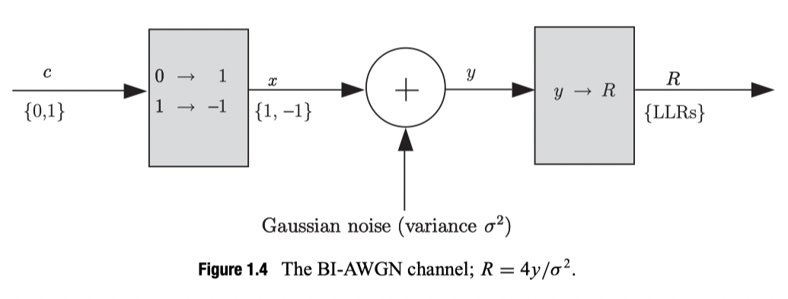

> Reference: *Iterative Error Correction Turbo, Low-Density*

## How are received-signal probabilities usually represented?

They are represented by log-likelihood ratios (LLRs), defined as follows:

$$
L(x)=\log \frac{p(x=0)}{p(x=1)}
$$

Here, $p(x=1)=1-p(x=0)$, and log denotes the natural logarithm with base $e$. If $p(x=0)>p(x=1)$, then $L(x)$ is positive.

Given the LLRs, the probabilities can be recovered using the following expressions:

$$
p(x=1)=\frac{p(x=1) / p(x=0)}{1+p(x=1) / p(x=0)}=\frac{e^{-L(x)}}{1+e^{-L(x)}}
$$

$$
p(x=0)=\frac{p(x=0) / p(x=1)}{1+p(x=0) / p(x=1)}=\frac{e^{L(x)}}{1+e^{L(x)}}
$$

One advantage of expressing probabilities logarithmically is that multiplication of probabilities becomes addition of their logarithms, reducing implementation complexity.

## Initializing receive probabilities for the BI-AWGN channel

The binary-input additive white Gaussian noise (BI-AWGN) channel can be described by

$$
y_{i}=\mu x_{i}+z_{i}
$$

where $x_i\in \{-1, +1\}$ is the $i$th transmitted symbol, $y_i$ is the $i$th received symbol, and $z_i$ is additive Gaussian noise with zero mean and variance $\delta^2$. This is often written as $z_i=AWGN(0, \delta)$.

The probability density function of $z$ is

$$
p(z)=\frac{1}{\sqrt{2 \pi \sigma^{2}}} e^{-z^{2} / 2 \sigma^{2}}
$$

When a binary codeword is transmitted over a BI-AWGN channel, its bits $c_i\in \{0, 1\}$ can be mapped to symbols $x_i\in \{-1, +1\}$ in either of two ways: $\{0 \rightarrow 1,1 \rightarrow-1\}$ or $\{0 \rightarrow-1,1 \rightarrow 1\}$. Here, we use $\{0 \rightarrow 1,1 \rightarrow-1\}$ as the example.

The received LLRs for the BI-AWGN channel are

$$
\begin{aligned}
R_{i}=L\left(x_{i} \mid y_{i}\right) &=\log \frac{p\left(c_{i}=0 \mid y_{i}\right)}{p\left(c_{i}=1 \mid y_{i}\right)} \\\\
&=\log \frac{p\left(x_{i}=1 \mid y_{i}\right)}{p\left(x_{i}=-1 \mid y_{i}\right)} \\\\
&=\log \frac{p\left(y_{i} \mid x_{i}=1\right) p\left(x_{i}=1\right) / p\left(y_{i}\right)}{p\left(y_{i} \mid x_{i}=-1\right) p\left(x_{i}=-1\right) / p\left(y_{i}\right)} \\\\
&=\log \frac{p\left(y_{i} \mid x_{i}=1\right) p\left(x_{i}=1\right)}{p\left(y_{i} \mid x_{i}=-1\right) p\left(x_{i}=-1\right)}
\end{aligned}
$$

This uses Bayes' rule, $p\left(x_{i} \mid y_{i}\right)=p\left(x_{i}, y_{i}\right) / p\left(y_{i}\right)=p\left(y_{i} \mid x_{i}\right) p\left(x_{i}\right) / p\left(y_{i}\right)$. If the symbols are equally likely, namely $p(x_i=-1)=p(x_i=1)$, then

$$
R_{i}=L\left(x_{i} \mid y_{i}\right)=\log \frac{p\left(y_{i} \mid x_{i}=1\right)}{p\left(y_{i} \mid x_{i}=-1\right)}
$$

For the BI-AWGN channel,

$$
\begin{aligned}
p\left(y_{i} \mid x_{i}=1\right) &=\frac{1}{\sqrt{2 \pi \sigma^{2}}} \exp \left(-\frac{\left(y_{i}-\mu\right)^{2}}{2 \sigma^{2}}\right) \\\\
p\left(y_{i} \mid x_{i}=-1\right) &=\frac{1}{\sqrt{2 \pi \sigma^{2}}} \exp \left(-\frac{\left(y_{i}+\mu\right)^{2}}{2 \sigma^{2}}\right)
\end{aligned}
$$

and the LLRs simplify to

$$
\begin{aligned}
R_{i}=L\left(x_{i} \mid y_{i}\right) &=\log \frac{\frac{1}{\sqrt{2 \pi \sigma^{2}}} \exp \left(-\frac{\left(y_{i}-\mu\right)^{2}}{2 \sigma^{2}}\right)}{\frac{1}{\sqrt{2 \pi \sigma^{2}}} \exp \left(-\frac{\left(y_{i}+\mu\right)^{2}}{2 \sigma^{2}}\right)} \\\\
&=\log \exp \left(-\frac{\left(y_{i}-\mu\right)^{2}}{2 \sigma^{2}}+\frac{\left(y_{i}+\mu\right)^{2}}{2 \sigma^{2}}\right) \\\\
&=\frac{1}{2 \sigma^{2}}\left(-\left(y_{i}^{2}-2 \mu y_{i}+\mu^{2}\right)+\left(y_{i}^{2}+2 \mu y_{i}+\mu^{2}\right)\right) \\\\
&=\frac{2 \mu}{\sigma^{2}} y_{i}
\end{aligned}
$$

The LLR for bit $c_i$ is sometimes called a soft decision on $c_i$. A hard decision on $c_i$ returns $c_i=0$ or $x_i=1$ when $R_i$ is positive, and $c_i=1$ or $x_i=-1$ when $R_i$ is negative.

## Other forms

When considering the relative noise level of the BI-AWGN channel, it is convenient to set $\mu=1$ and vary $\delta$ to represent the channel's noise level. In this case, $R_i$ can be written as

$$
R_{i}=\frac{2}{\sigma^{2}} y_{i}
$$

**Expressing it in terms of $E_b/N_0$**

The noise level is usually expressed as the ratio of energy per symbol $E_s$ to noise spectral density $N_0$:

$$
\frac{E_{s}}{N_{0}}=\frac{\mu^{2}}{2 \sigma^{2}}
$$

The expression $y_{i}=\mu x_{i}+z_{i}$ is therefore sometimes written as

$$
y_{i}=\sqrt{E_{s}} x_{i}+z_{i}
$$

For the BI-AWGN channel, $r$ is the ratio of information bits to transmitted bits: the code rate. With binary input, $E_s$ is the energy per transmitted bit.

For a channel using error-correcting codes, the noise level is often expressed by $E_b/N_0$, where $E_b$ is the energy per information bit.

We have

$$
\frac{E_{b}}{N_{0}}=\frac{1}{r} \frac{E_{s}}{N_{0}}=\frac{1}{r} \frac{\mu^{2}}{2 \sigma^{2}}
$$

so the received LLR is

$$
R_{i}=L\left(x_{i} \mid y_{i}\right)=4 \frac{\sqrt{E_{s}}}{N_{0}} y_{i}=4 \frac{\sqrt{r E_{b}}}{N_{0}} y_{i}
$$

When $\mu$ is 1,

$$
R_{i}=\frac{4}{N_{0}} y_{i}
$$

where $E_b/N_0$ can also be expressed in decibels:

$$
\frac{E_{b}}{N_{0}}(\mathrm{~dB})=10 \log _ {10} \frac{E_ {b}}{N_{0}}=10 \log _{10} \frac{\mu^{2}}{2 r \sigma^{2}}
$$

> Note that $E_s$ is the energy per transmitted symbol, or per transmitted bit for binary input. It concerns transmitted symbols, rather than information symbols. By contrast, $E_b$ is the energy per information bit. The code rate relates the two.

