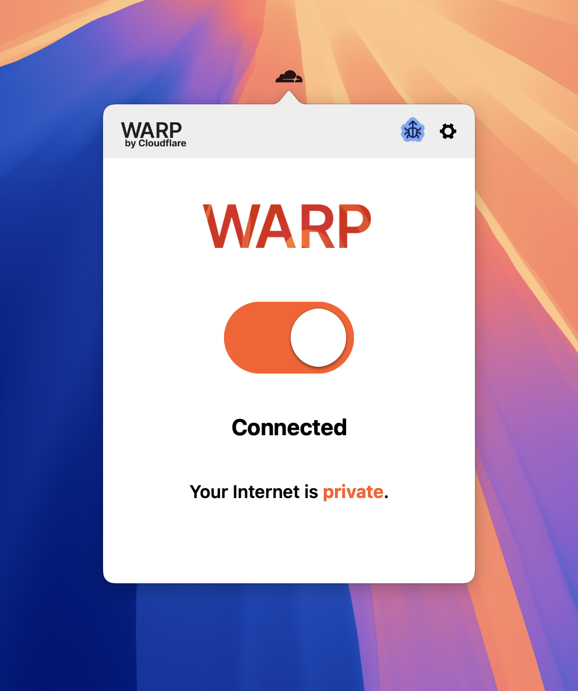

> This article is for technical discussion only. If you have a simpler or more convenient method, I would be happy to discuss it.

## Background

When studying at universities abroad, such as UTS or Macquarie University, accessing websites in China can often be slow. Alibaba services and university websites in China, for example, can take frustratingly long to load. Sometimes even checking a university announcement becomes difficult, seriously affecting productivity and creating a need for faster access.

## The explanation: the university blocks some traffic to China

University networks commonly use firewalls to block or restrict particular websites, especially traffic to certain regions. To get around these restrictions, the traffic needs to be encrypted so that the university firewall cannot identify its contents. More specifically, our device encrypts its traffic and sends it to an intermediary server, or VPS. That server requests the destination website on our behalf and returns an encrypted response. The firewall then sees only encrypted traffic and cannot determine which websites we are visiting, allowing us to bypass the restrictions. Many universities also provide VPNs so that people outside campus can access university resources, and those VPNs can help improve access to sites in China. Unfortunately, my university only provided WebVPN. A conventional VPN required an application to the university, which was a little inconvenient, so I preferred to find my own solution.

With that explanation in mind, there are two approaches:

1. Use an existing network-security and encryption tool. I recommend WARP.
2. Set up a server yourself and establish an encrypted connection.

## WARP

Cloudflare provides WARP, a cross-platform application that can be used after downloading it. Its main purpose is to encrypt traffic between your device and the internet, improving security and privacy while also optimizing connection speed. WARP runs on Cloudflare's globally distributed data centers and can reduce latency to make browsing smoother.

Link: [Warp](https://one.one.one.one/)

Download it, open it, and turn it on.

---

The second approach has a higher barrier to entry. I do not know how to do it myself either.
