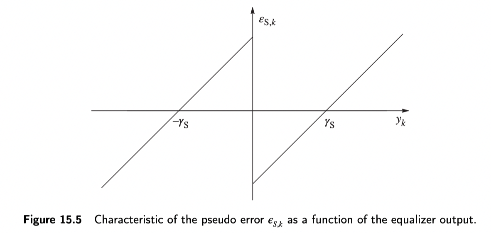
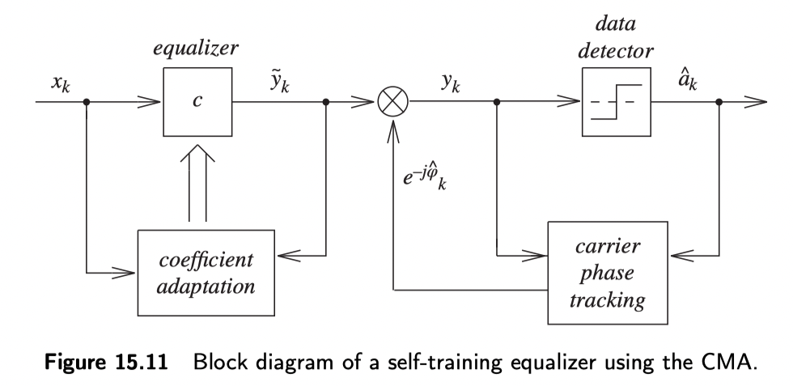
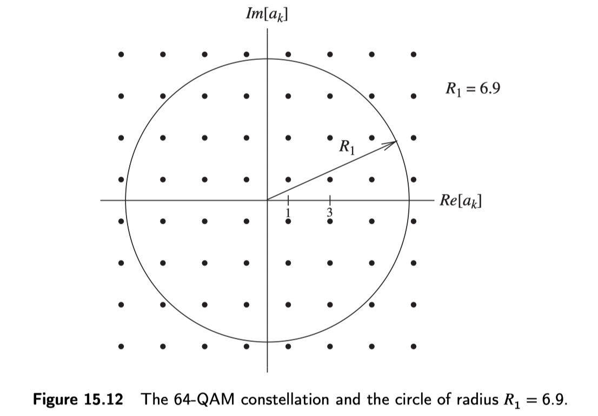

> References:
*Research on Blind Equalization Algorithms for High-Order QAM Signals*
*Algorithms for Communications Systems and their Applications*
*Hybrid Methods for Blind Adaptive Equalization: New Results and Comparisons*

## Principles of adaptive equalization

An adaptive equalizer can be viewed as two components: a filtering subsystem and an adaptation algorithm. An equalizer is therefore fundamentally a filter. More precisely, adaptive equalization is an application of adaptive filtering to compensating for channel-induced intersymbol interference (ISI).

## Modeling the adaptive-equalization problem

> Reference: *Algorithms for Communications Systems and their Applications*
From the knowledge of the probability distribution of the channel input symbols $\lbrace a_k\rbrace$ and from the observation of the channel output sequence $\lbrace x_k\rbrace$, we want to find an equalizer $C$ such that the overall system impulse response is inter-symbol interference (ISI) free.

Suppose a nonminimum-phase system has the rational transfer function

$$
H(z)=H_{0} \frac{P_{1}(z) P_{2}(z)}{P_{3}(z)}
$$

where $H_ 0$ is the gain; $P_ 3(z)$ and $P_ 1(z)$ are first-degree polynomials with zeros inside the unit circle; and $P_ 2(z)$ is a first-degree polynomial with its zero outside the unit circle. Inverting $P_ 1(z)$ and $P_ 2(z)$ and expressing the results as Laurent expansions gives

$$
\begin{aligned}
&P_{1}^{-1}(z)=\sum_{n=0}^{+\infty} c_{1, n} z^{-n} \\
&P_{2}^{-1}(z)=\sum_{n=-\infty}^{0} c_{2, n} z^{-n}
\end{aligned}
$$

Therefore,

$$
H^{-1}(z)=\frac{1}{H_{0}} P_{3}(z)\left(\sum_{n=0}^{+\infty} c_{1, n} z^{-n}\right)\left(\sum_{n=-\infty}^{0} c_{2, n} z^{-n}\right)
$$

Because the input signal is symmetric, $\left\lbrace-a_{k}\right\rbrace$ and $\left\lbrace-a_{k}\right\rbrace$ have the same statistical properties. We cannot therefore distinguish whether the desired equalizer is $H^{-1}$ or $-H^{-1}$. The equalizer solution is consequently $C=\pm H^{-1}$, making the overall system response $\Psi=\pm I$.

### Theorem

If the input symbols are non-Gaussian, and the output symbols

$$
y_{k}=\sum_{n=-\infty}^{+\infty} c_{n} x_{k-n}
$$

have the same distribution as the input, then the system satisfies $\Psi=\pm I$.

This theorem can be used to determine whether the equalizer $C$ makes the output distribution converge to the input distribution. Define the cost function as

$$
J=E\left[\Phi\left(y_{k}\right)\right]
$$

where $\Phi$ is a chosen real-valued even function. The optimal solution is then

$$
C_{o p t}(z)=\arg \min _{C(z)} J
$$

This identifies the value of $c$ when $\pm H^{-1}$.

Suppose the equalizer coefficient vector has length $N$. Then

$$
\boldsymbol{c}_ {k}=\left[c_ {0, k}, c_{1, k}, \ldots, c_{N-1, k}\right]^{T}
$$

Let the input be

$$
\boldsymbol{x}_ {k}=\left[x_ {k}, x_{k-1}, \ldots, x_{k-(N-1)}\right]^{T}
$$

and the output is

$$
y_{k}=\sum_{n=0}^{N-1} c_{n, k} x_{k-n}=c_{k}^{T} \boldsymbol{x}_ {k}
$$

Similarly, the coefficients can be written more compactly as

$$
c_{o p t}=\arg \min_{c} J
$$

Suppose the derivative of $\Phi$ is $\Theta$. The gradient of $J$ with respect to $c$ is

$$
\nabla_{c} J=E\left[\boldsymbol{x}_{k}\Theta (y_k)\right]
$$

To minimize $J$, use stochastic gradient descent:

$$
c_{k+1}=c_{k}-\mu \Theta\left(y_{k}\right) \boldsymbol{x}_{k}
$$

Here, $\mu$ is the adaptation gain. Whether the algorithm converges to $H^{-1}$ or $-H^{-1}$ depends on the choice of initial coefficients $C$.

The cost function $\Phi$ chosen for the equalizer iterations is important.

---

## The Sato algorithm for PAM systems

The Sato cost function is defined as

$$
J=E\left[\frac{1}{2} y_{k}^{2}-\gamma_{S}\left|y_{k}\right|\right]
$$

where

$$
\gamma_{S}=\frac{E\left[a_{k}^{2}\right]}{E\left[\left|a_{k}\right|\right]}
$$

The gradient of $J$ is

$$
\nabla_{\boldsymbol{c}} J=E\left[\boldsymbol{x}_ {k}\left(y_{k}-\gamma_{S} \operatorname{sgn}\left(y_{k}\right)\right)\right]
$$

Introduce the signal

$$
\epsilon_{S, k}=y_{k}-\gamma_{S} \operatorname{sgn}\left(y_{k}\right)
$$

During self-training, suppose the expected pseudo-error replaces the error term of the least-mean-square (LMS) decision algorithm. The LMS error signal is

$$
e_{k}=y_{k}-\hat{a}_ {k}
$$

where $ \hat{a}_ {k}$ is the decision on symbol $a_ k$, obtained by passing sample $y_ k$ through a threshold detector. The figure below shows pseudo-error $\epsilon_{S, k}$ as a function of output sample $y_ k$.



The Sato coefficient update is therefore

$$
\boldsymbol{c}_ {k+1}=\boldsymbol{c}_ {k}-\mu \epsilon_ {S, k} \boldsymbol{x}_ {k}
$$

It can be shown that, if the output symbols $\lbrace a_{k}\rbrace$ are sub-Gaussian, the Sato cost function leads the system, after a certain lag, to a unique $C=\pm H^{-1}$.

### Limitations of the Sato algorithm

1. The uniqueness of the point minimizing the Sato cost function assumes a continuous probability distribution of the input symbols. With a discrete probability distribution, the convergence behavior is less satisfactory.
2. At $C=\pm H^{-1}$, the pseudo-error $\epsilon_{S, k}$ is not zero unless the system uses binary transmission.
3. The variance of the pseudo-error can remain non-negligible in a neighborhood of the desired solution.

One point worth observing is that the cost function being minimized contains the term $E\left[\left|y_{k}\right|^{p}\right]$, where $p\geq 2$. This means the cost function emphasizes the contribution of the sample amplitudes.

## Adaptive equalization for QAM systems

### Constant-modulus algorithm (CMA)

Originally proposed by Godard, its cost function is

$$
J=E\left[\left(\left|\tilde{y}_ {k}\right|^{p}-R_{p}\right)^{2}\right]=E\left[\left(\left|y_{k}\right|^{p}-R_{p}\right)^{2}\right]
$$

Here, $p$ is a parameter, usually $p=1$ or $p=2$. Because the cost function $J$ depends on the $p$th power of the equalizer output's magnitude, CMA does not require carrier-phase estimation. The following figure is a receiver block diagram using a CMA equalizer.



The gradient of the expression above is

$$
\nabla_{c} J=2 p E\left[\left(\left|\tilde{y}_ {k}\right|^{p}-R_{p}\right)\left|\tilde{y}_ {k}\right|^{p-2} \tilde{y}_ {k} \boldsymbol{x}_ {k}^{*}\right]
$$

The constant $R_p$ is chosen to make the gradient zero when equalization is good. Thus,

$$
R_{p}=\frac{E\left[\left|a_{k}\right|^{2 p}\right]}{E\left[\left|a_{k}\right|^{p}\right]}
$$

> Why divide two expectations here instead of taking the expectation of the ratio?
Taking the expectation after division would introduce a covariance term. The two random variables both involve $a_k$, so their covariance is nonzero. The expectation of their ratio would therefore not be the expectation of the $p$th power of the radius.

For a 64-QAM constellation, the expression above gives $R_ 1 = 6.9$ and $R_ 2 = 58$. The code for calculating these two radii is

```MATLAB
p = 2;
E1 = 0;
E2 = 0;
for i = 1:2:7
  for j = 1:2:7
    E1 = 1/16 * (sqrt(i^2+j^2) ^ p) + E1;
    E2 = 1/16 * (sqrt(i^2+j^2) ^ (2*p)) + E2;
  end
end
E2/E1
```

The circle with radius $R_ 1=6.9$ sits within the 64-QAM constellation as follows:



The equalizer coefficients can be updated using the gradient through

$$
\boldsymbol{c}_ {k+1}=\boldsymbol{c}_ {k}-\mu\left(\left|\tilde{y}_ {k}\right|^{p}-R_{p}\right)\left|\tilde{y}_ {k}\right|^{p-2} \tilde{y}_ {k} \boldsymbol{x}_ {k}^{* }
$$

For $p=1$, this simplifies to

$$
\boldsymbol{c}_ {k+1}=\boldsymbol{c}_ {k}-\mu\left(\left|\tilde{y}_ {k}\right|-R_{1}\right) \frac{\tilde{y}_ {k}}{\left|\tilde{y}_ {k}\right|} \boldsymbol{x}_ {k}^{*}
$$

This is the CMA algorithm. The Sato algorithm is a special case of CMA.

### Advantages and disadvantages of CMA

**Advantages**

1. Good robustness.
2. Low complexity.
3. Widely used.
4. Can operate before carrier recovery.

**Disadvantages**

1. Relatively slow time to convergence (TTC).
2. A constant phase offset remains at convergence.

## Multimodulus algorithm (MMA)

> Reference: *Hybrid Methods for Blind Adaptive Equalization: New Results and Comparisons*

MMA separates the equalizer output into in-phase and quadrature components. For a square QAM constellation, the MMA error is

$$
\begin{array}{r}
E_{n, R}^{m m a}=y_{n, R}\left(y_{n, R}^{2}-R_{M}\right) \\
E_{n, I}^{m m a}=y_{n, I}\left(y_{n, I}^{2}-R_{M}\right) \\
E_{n}^{m m a}=E_{n, R}^{m m a}+j \cdot E_{n, I}^{m m a}
\end{array}
$$

Here, $R$ and $I$ denote the real and imaginary components, respectively, and $R_M$ is a constant defined as

$$
R_{M}=\frac{\mathrm{E}\left\lbrace a_{n}^{4}\right\rbrace}{\mathrm{E}\left\lbrace a_{n}^{2}\right\rbrace}
$$

### Advantages and disadvantages of MMA

Compared with CMA, MMA has a lower MSE and does not require phase recovery. Its convergence rate, however, is similar to CMA's, and it is less robust.

## Decision-directed (DD) algorithm

The DD algorithm replaces symbol statistics with symbol estimates when updating the equalizer taps. The DD error is defined as

$$
E_ {n}^{d d}=y_ {n}-\hat{s}_ {n}
$$

where $\hat{s}_ {n}$ is an estimate of the constellation point.

### Advantages and disadvantages of DD

DD has a lower MSE and less jitter. However, it converges only when the MSE is below a fixed threshold. Thresholds for QAM constellations have been derived in the literature.

## Modified CMA (MCMA)

Compared with the CMA error function, MCMA adds a constellation-matched error (CME) term. This can significantly reduce both TTC and MSE. The MCMA error is defined as

$$
E_{n}^{m c m a}=y_{n}\left(\left|y_{n}\right|^{2}-R_{C}\right)+\beta \eta_{n}
$$

where $\beta$ is the CME weighting factor and $\eta_ n$ is the CME term, defined as

$$
\eta_{n}=\left.\frac{d}{d x} g(x)\right|_ {x=y_ {n, R}}+\left.j \frac{d}{d x} g(x)\right|_ {x=y_ {n, I}}
$$

Here, $g(x)$ is the CME function, which is zero at the symbol points of a QAM constellation. $g(x)$ is defined as

$$
g(x)=1-\sin ^{2 p}\left(\frac{x \pi}{2 d}\right)
$$

where $p$ is a positive integer and $d$ is the distance between constellation points.

### Advantages and disadvantages of MCMA

Compared with CMA, MCMA offers a lower MSE, less jitter, and a shorter TTC. However, it requires prior phase recovery and has higher complexity. Implementing the CME term as a lookup table requires substantial hardware area.

## CMA–MMA

The CMA–MMA algorithm uses an asymmetric cost function: the in-phase filter uses the CMA error, while the quadrature filter uses the MMA error. The CMA–MMA error is defined as

$$
\begin{array}{r}
E_{n, R}^{c m a-m m a}=y_{n, R}\left(\left|y_{n}\right|^{2}-R_{C}\right) \\
E_{n, I}^{c m a-m m a}=y_{n, I}\left(y_{n, I}^{2}-R_{M}\right) \\
E_{n}^{c m a-m m a}=E_{n, R}^{c m a-m m a}+j \cdot E_{n, I}^{c m a-m m a}
\end{array}
$$

### Advantages and disadvantages of CMA–MMA

Advantages:

1. Lower MSE than CMA.
2. Good robustness.
3. No prior phase recovery is required, even though the MMA error term can rotate the constellation.

Disadvantages:

1. A similar convergence rate.
2. Potentially larger jitter.

## CMA-assisted decision-adjusted modulus algorithm (CADAMA)

CADAMA is a dual-mode algorithm. CMA first reduces the MSE to improve the decision step in the second mode. The cost function of the decision-adjusted modulus algorithm (DAMA) is zero on each ring of a QAM constellation. DAMA is used in the second mode, with the error term defined as

$$
E_{n}^{d a m a}=\min _ {i}\left[y_ {n}\left(\left|y_{n}\right|^{2}-R_{i}\right)\right]
$$

Here, $1 \leq i \leq p$, $\left\lbrace R_{i}\right\rbrace_{i=1}^{p}$ is the radius associated with a signal point in the QAM constellation, and $p$ is an integer greater than one.

### Advantages and disadvantages of CADAMA

Advantages:

1. Lower MSE.
2. Less jitter than CMA.

Disadvantages:

1. Higher-order QAM constellations require more decision regions, increasing the chance of selecting the wrong region.
2. Under severe channel distortion, the error rate associated with DAMA's cost function is too high for convergence. DAMA is therefore unreliable in the initial equalization phase and cannot be cold-started.

### Switching criteria between CMA and DAMA

> CADAMA first uses CMA to initialize the equalizer, then switches to DAMA once amplitude equalization is complete. DAMA works by making the cost function zero on each ring of the QAM constellation, reducing jitter by 18 to 25 dB for many standard QAM constellations.

The switching criterion compares the histogram of observed radii over an observation interval with the radius-distribution template of the QAM constellation, using a goodness-of-fit test to guide the switch.

#### QAM radius-distribution template

Let $p_ i$ denote the template probability for signal-point radius $i$. Then $p_i = (\text{number of signal points on radius} \quad i)/M$, where $M$ is the modulation order and $\sum_{i=1}^{\rho} p_{i}=1$.

#### Observation interval

Let $N$ denote the observation interval. Its relationship with $M$ is $N=\kappa M$. The observation interval $\kappa M$ produces an observation $K$ for each symbol $a_ m$. Here, $\kappa = 20$ can be used.

## Performance criteria for blind equalization

### Convergence speed

An algorithm with strong convergence capability usually also has good cold-start capability: it is relatively easy to bring to convergence.

### Mean-square decision error

The mean-square error (MSE) is defined as

$$
M S E=E\left\lbrace|d(n)-\mathrm{y}(n)|^{2}\right\rbrace
$$

where $d(n)$ is the desired signal and $y(n)$ is the equalizer output.

### Residual ISI

Define the ISI performance measure for a blind-equalization algorithm as

$$
\operatorname{ISI}(n)=\frac{\sum\left|\mathbf{h}_ {w}(n)\right|^{2}-\max \left|\mathbf{h}_ {w}(n)\right|^{2}}{\max \left|\mathbf{h}_{w}(n)\right|^{2}}
$$

Here, $\operatorname{ISI}(n)$ is the residual intersymbol interference after iteration $n$. $\sum\left|\mathbf{h}_ {w}(n)\right|^{2}$ is the sum of the squares of all $n$ in the combined impulse response $\mathbf{h}_ {w}(n)$, while $\max \left|\mathbf{h}_ {w}(n)\right|^{2}$ is the square of the largest term in the combined impulse response $\mathbf{h}_{w}(n)$.

### Symbol error rate

In most cases, the symbol error rate is consistent with the blind-equalization algorithm's mean-square decision error and residual ISI.
