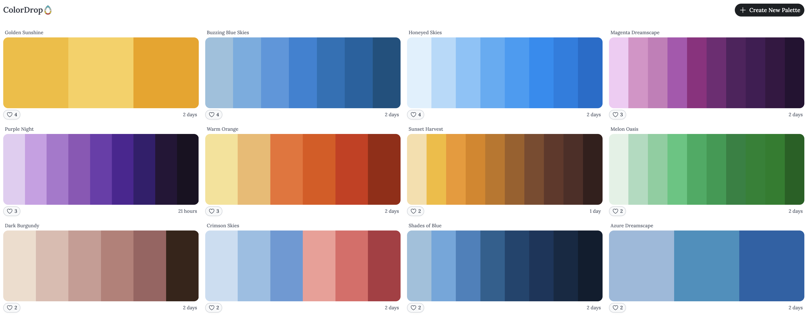

> A loose collection of color resources and personal thoughts. Comments are welcome.

## Colors for presentations and block diagrams

Choosing and combining colors is often a headache when making slides or block diagrams. You have probably seen slides full of bright red and purple, with saturation turned all the way up. Perhaps their authors care more about the content, but I hope my slides will not look like that. As a university student, I think it is worth having some basic visual judgment. The result does not need to be sophisticated; at least it should not make the audience want to leave immediately.

People say that a slide or block diagram should use no more than three or four colors. I understand the principle, but how should those colors be combined? I have briefly looked at design websites such as Google's [Material Design](https://m3.material.io/). They seem to be written for designers and mainly explain design principles, rather than catering to someone as lazy as me. Although there are [Color resources](https://m3.material.io/styles/color/resources), they are not something I can simply pick up and use. For someone without design training, understanding a page does not automatically make its advice easy to apply.

There are also plenty of color-palette websites:

- [color hunt](https://colorhunt.co/)
- [colordrop](https://colordrop.io/)
- [Grabient](https://www.grabient.com/)
- [Picular](https://picular.co/)
- [Adobe Color](https://color.adobe.com/zh/)
- [ColorSpace](https://mycolor.space/)
- And many more.

That should be enough in theory, but it still does not quite feel right. Every site looks something like this:

There is also the problem of having too many choices.

Someone recently made [CNScolor](https://github.com/ZhengTiger/CNScolor), a project that may offer more guidance on color schemes. It is worth a look.

Later, I found a simpler source of complete color schemes: themes. For example, a theme chosen in VS Code includes a whole coordinated set of colors. In practice, I have found the [Nord theme](https://www.nordtheme.com/) useful. I also tried using its colors for an academic presentation ([VTC 2025 Presentation](https://github.com/zhaoliangbin42/VTC2025-SWIP-MUSIC/blob/master/Presentation-Latex/VTC-2025-Liangbin.pdf)), and thought the result worked well. It is something you could try.

[Happy Hues](https://www.happyhues.co/palettes/15) also offers a number of themes to explore.

## MATLAB figures

I recently found [Colormap by pratiman](https://pratiman-91.github.io/colormaps/docs/Scientific), a blog with many color schemes. They look useful for heatmaps and similar figures.
