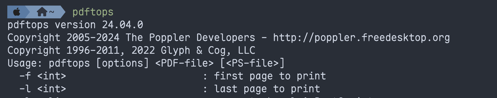
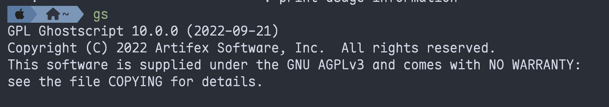

> The methods discussed here are for Mac. If you copy this article into ChatGPT and ask for an equivalent approach on another operating system, that should be straightforward.

## Basic conversion methods

1. Use pdftops.
2. Use Ghostscript. Both pdftops and GS can convert PDF files directly to EPS, but I am personally not very satisfied with the result: the output EPS is rasterized, and jagged edges become visible when enlarged. **Nevertheless, the main purpose of this article is to provide a script for this method.**
3. Export the figure again from the software that originally created it. This is the least efficient option, but gives **the best results**. It is still the best approach.

The first two tools should be available from the command line after installing MacTeX. Open a terminal and enter `pdftops` or `gs` to inspect the output.





If they produce output, the tools are available. Below is a batch-conversion script using Ghostscript.

## Ghostscript batch-processing script

> Generated with ChatGPT.

```bash
#!/bin/bash

# 设置输出目录（可选）
output_dir="./eps_output"
mkdir -p "$output_dir"

# 遍历当前目录下所有 pdf 文件
for pdf_file in *.pdf; do
    # 提取文件名（不含扩展名）
    base_name="${pdf_file%.pdf}"
    eps_file="$output_dir/${base_name}.eps"

    echo "Converting $pdf_file -> $eps_file"

    gs -dNOPAUSE -dBATCH -dSAFER \
       -sDEVICE=eps2write \
       -dEPSCrop \
       -sOutputFile="$eps_file" "$pdf_file"
done

echo "All conversions done."

```

1. In the folder containing the PDFs you want to convert, create a file named `pdf2eps.sh`, paste the script into it, then save and close it.
2. Open a terminal and change the script's permissions with `sudo chmod +x ./pdf2eps.sh`.
3. Run `./pdf2eps.sh` to convert all PDF files in that folder.

> Please inspect the converted files yourself. It is better to find any conversion problems before submitting them.
