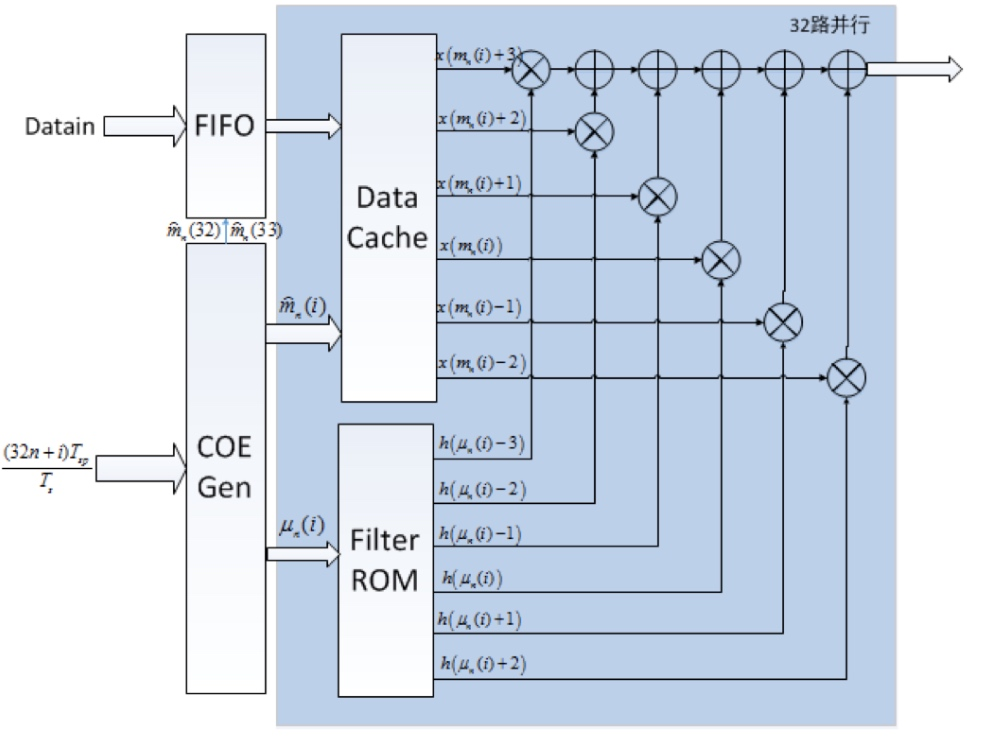
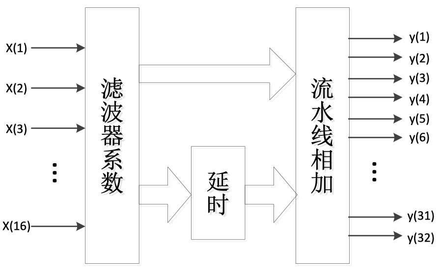

> These notes use the thesis *Design and Implementation of a Broadband 16QAM/16APSK Modem with a Flexibly Variable Rate* as study material.

## Implementing variable-rate pulse shaping

### The pulse-shaping expression

When the overall response of a baseband system is equivalent to an ideal low-pass filter, intersymbol interference can be eliminated. An ideal low-pass filter cannot be implemented in practice, however. A root-raised-cosine filter is therefore used at the transmitter for pulse shaping, and another root-raised-cosine filter is used at the receiver for matched filtering. This makes the overall channel equivalent to a filter with a response close to the desired low-pass characteristic: the response is greatest at the sampling instant for the current symbol ($t=0$) and zero at the sampling instants of the other symbols ($t=\pm k T_{s}$).

The time-domain response of a root-raised-cosine filter is
$$
h_{T}(t)=h_{R}(t)=4 \alpha \frac{\cos \left((1+\alpha) \pi t / T_{s}\right)+\frac{\sin \left((1-\alpha) \pi t / T_{s}\right)}{\left(4 \alpha t / T_{s}\right)}}{\pi \sqrt{T_{s}}\left(1-\left(4 \alpha t / T_{s}\right)^{2}\right)}
$$

### Deriving rate conversion through digital resampling

> What does variable rate mean, and why is rate conversion necessary? Why do we need high-speed parallel modulation with a variable symbol rate?

1. The sampling rate of the transmitter's DAC or receiver's ADC is usually fixed at the start of the design so that the implementation operates correctly. The symbol rate, however, may be adjusted for the application. At a fixed sampling rate, this changes the oversampling factor, which can sometimes be fractional. The pulse-shaping filter therefore needs a dedicated design with variable-rate support to accommodate input signals at different rates.
2. The processing clock inside an FPGA generally does not exceed 200 MHz. Achieving modulation at gigabits per second requires a fully parallel architecture, so the modulator must be parallelized.

---

According to the Nyquist sampling theorem, provided the sampling frequency exceeds twice the signal bandwidth, the original signal $y(t)$ can be reconstructed from its samples $x(nT_s)$:
$$
y(t)=\sum_{n=-\infty}^{+\infty} x\left(n T_{s}\right) h\left(t-n T_{s}\right)
$$
Here, $x(t)$ is the input signal, $h(t)$ is the filter's time-domain response, and $T_s$ is the symbol period.

> The physical meaning is that obtaining the output signal $y(t)$ requires convolving the input signal with the filter. Notice that the input is discrete, with sampling instants $nT_s$, while the filter's time-domain response is centered at $t$. This is a familiar expression, but understanding it thoroughly is essential to following the derivation below.

If we resample this reconstructed signal—that is, obtain its value at a desired point—the first idea is to replace $t$ in the expression above with the time of that point, such as $kT_{sp}$. This gives
$$
y\left(k T_{sp}\right)=\sum_{n=-\infty}^{+\infty} x\left(n T_{s}\right) h\left(k T_{sp}-n T_{s}\right)=\sum_{n=-\infty}^{+\infty} x\left(n T_{s}\right) h\left(T_{s}\left(\frac{k T_{sp}}{T_{s}}-n\right)\right)
$$

> Here, $T_{sp}$ can be understood as the DAC sampling period. Physically, we want to modulate the symbols at the specified sampling period $T_{sp}$, and the expression above gives $y(kT_{sp})$. The information-symbol period is currently $T_s$, corresponding to the lower rate, while the DAC samples with period $kT_{sp}$, corresponding to the higher rate. We therefore use the expression to pulse-shape the slower information symbols into a faster signal for the DAC to output.
>
> We can see that $x(nT_s)$ is independent of $x(T_{sp})$ and depends only on $h(t)$.

To simplify the expression, let $m_{k}=\left\lfloor\frac{k T_{sp}}{T_{s}}\right\rfloor$ and $\mu_{k}=\frac{k T_{sp}}{T_{s}}-m_{k}$. Substituting gives
$$
y\left(k T_{sp}\right)=\sum_{n=-\infty}^{+\infty} x\left(n T_{s}\right) h\left(\left(m_{k}+\mu_{k}-n\right) T_{s}\right)
$$
Then let $m=m_{k}-n$, giving
$$
y\left(k T_{sp}\right)=\sum_{m=-\infty}^{+\infty} x\left(\left(m_{k}-m\right) T_{s}\right) h\left(\left(\mu_{k}+m\right) T_{s}\right)
$$

> After this simplification, $y(kT_{sp})$ depends only on $x\left(\left(m_{k}-m\right) T_{s}\right)$ and $h\left(\left(\mu_{k}+m\right) T_{s}\right)$. The integer parameter involved is $m_k, m$, and the fractional parameter is $\mu_k$. For $x(t)$, the index must be an integer, so $m_k-m$ satisfies the requirement and selects an ordinary element from the $x$ sequence. For $h$, the fractional part means that we first oversample $h$ and then perform ordinary selection. The position represented by $m$ is the correct sampling point before the offset is applied; adding $\mu_k$ introduces the offset.
>
> **A question**
>
> To me, the two expressions above look equivalent. But once their ranges are specified, are they still equivalent?

An infinite summation cannot be implemented, so the filter can be truncated:
$$
\begin{aligned}
y\left(k T_{sp}\right) &=\sum_{m=-I_{1}}^{I_{2}} x\left(\left(m_{k}-m\right) T_{s}\right) h\left(\left(\mu_{k}+m\right) T_{s}\right) \\\\
&=\sum_{m=-I_{1}}^{I_{2}} h_{T}\left(\mu_{k}+m\right) x\left(m_{k}-m\right)
\end{aligned}
$$
For both $x$ and $h$, $T_s$ indicates selection within a sequence and acts as a scale factor. We can therefore set that scaling relationship aside and focus on mapping $x((m_k-m)-T_s)$ to $x(m_k-m)$.

### Designing the variable-rate pulse-shaping filter

On an FPGA, $h_{T}\left(\mu_{k}+m\right)$ cannot be calculated in real time, so a lookup table is used. The oversampling factor determines the precision of $\mu_k$. If the precision of $\mu_k$ is set to $\frac{1}{2^{-12}}$, then at a sampling rate of 5 Gsps the variable-rate step size is $1.22Msps$.

Following the previous section, suppose that the effects of symbols more than three symbol intervals before or after the current symbol are negligible. Truncating the filter gives
$$
y(kT_{sp})=\sum_{m=-3}^{+2} h_{T}\left(\mu_{k}+m\right) x\left(m_{k}-m\right)
$$

> Implementation:
>
> Use MATLAB's rcosdesign function to generate coefficients with α = 0.35, an oversampling factor of 4096, and a span of six symbols across both sides. Quantize the coefficients to 12 bits, then split them by symbol into six groups of 4096 coefficients. Store the groups in six ROM cores, each 12 bits wide and 4096 entries deep. Scale both $\mu_k$ and $m$ by $2^{12}$ to obtain address indices, and retrieve the six coefficients required for the calculation.

At a sampling rate of 5 Gsps and a clock frequency of 200 MHz or less, 32 parallel paths are required. The expression can be rewritten as
$$
y(32n+i) = \sum_{m=-3}^{+2}h_T(\mu_n(i)+m)x(m_n(i)-m)
$$
Here, $n$ is the time index and $i$ is the parallel-path index. $m_{n}(i)=\left\lfloor\frac{(32 n+i) T_{s p}}{T_{s}}\right\rfloor$ and $\mu_{n}(i)=\frac{(32 n+i) T_{s p}}{T_{s}}-m_{n}(i)$.

The implementation block diagram is shown below. The input symbol data first passes through a FIFO and then enters DataCache. COEGen calculates $m_n(i)$ and $\mu_n(i)$, which select six pairs of symbols and filter coefficients from DataCache and FilterRom. Multiplying and summing those pairs produces one pulse-shaped output path.

### Some parameter choices for the variable-rate pulse-shaping module

The highest sampling rate used in this project is $5Gsps$, and the highest symbol rate is $1200Msps$. Under these conditions, $\frac{32T_{sp}}{T_s}=7.68$. Thus, with 32 parallel paths, $m_n(1)$ and $m_n(32)$ differ by at most 8, so $m_n(i)$ ranges over $[0, 7]$. Accounting for $m_{n}(1)-2$ and $m_{n}(32)+3$, a total of 13 symbols is needed for 32-path parallel pulse shaping. DataCache therefore buffers one clock cycle of the eight parallel symbols arriving from the FIFO. Together with the data from the next cycle, this forms 16 parallel symbols and meets the filter's rate requirement.

For register addressing, we represent $\frac{(32 n+i) T_{s p}}{T_{s}}$ using 53 bits to achieve the required precision: three integer bits and fifty fractional bits. In other words, $m_n(i)$ uses the three integer bits, while $\mu_n(i)$ uses the highest twelve fractional bits.

For the FIFO readout strategy, refer directly to the source material.

---

## Implementing a high-speed parallel matched filter

### The $Z$-transform

> Applying $\delta(n)$ to a system gives its impulse response $h(n)$; for example, $h(n)=\left[\begin{array}{lll}1 & 2 & 1\end{array}\right]$.
>
> Now suppose another signal is applied to the system, for example $x(n)=[1\quad 2\quad 1]=\delta(n)+2 \delta(n-1)+\delta(n-2)$.
>
> The output should be $y(n)=[1\quad 4\quad 6\quad 4\quad 1]=h(n)+2 h(n-1)+h(n-2)=x(n)* h(n)$, obtained by convolution.
>
> On inspection, this is simply polynomial multiplication of $[1\quad 2\quad 1]$ and $[1\quad 2\quad 1]$!
>
> We therefore rewrite the signal $x(n)$ as $X(Z)=1+2 Z^{-1}+Z^{-2}$ and likewise write the impulse response as $H(Z)=1+2 Z^{-1}+Z^{-2}$. Then $Y(Z) = 1+4 Z^{-1}+6 Z^{-2}+4 Z^{-3}+Z^{-4} = X(Z)H(Z)$. This is called the $Z$-transform.
>
> ⭐️ **$Z^{-1}$ corresponds to data from the next clock cycle—the future.**

### Derivation

An Nth-order FIR filter can be expressed in the time domain as
$$
y(n)=h(n) * x(n)=\sum_{i=0}^{N-1} h(i) x(n-i), \quad n=0,1,2, \ldots, \infty
$$
Its Z-transform is
$$
Y(z)=H(z) \cdot X(z)=\left(\sum_{n=0}^{N-1} h(n) z^{-n}\right) \cdot\left(\sum_{n=0}^{\infty} x(n) z^{-n}\right)
$$
Following the thesis, the $z$-transforms of sequences $x(n)$ and $h(n)$ can be separated into the $Z$-transforms of their even- and odd-indexed subsequences:
$$
\begin{aligned}
X(z) &=x(0)+x(1) z^{-1}+x(2) z^{-2}+x(3) z^{-3}+\cdots+x(n) z^{-n} \\\\
&=\left[x(0)+x(2) z^{-2}+x(4) z^{-4}+x(6) z^{-6} \cdots\right] \\\\
&+z^{-1}\left[x(1)+x(3) z^{-2}+x(5) z^{-4}+x(7) z^{-6} \cdots\right] \\\\
&=X_{0}\left(z^{2}\right)+z^{-1} X_{1}\left(z^{2}\right)
\end{aligned}
$$
Similarly,
$$
H(z)=H_{0}\left(z^{2}\right)+z^{-1} H_{1}\left(z^{2}\right)
$$

The corresponding $y(n)$ sequence can also be written as the sum of even- and odd-indexed subsequences:
$$
Y(z)=Y_{0}\left(z^{2}\right)+z^{-1} Y_{1}\left(z^{2}\right)
$$

$$
\begin{array}{c}
Y_{0}\left(z^{2}\right)=X_{0}\left(z^{2}\right) H_{0}\left(z^{2}\right)+\mathrm{z}^{-2}\left(X_{1}\left(z^{2}\right) H_{1}\left(z^{2}\right)\right) \\\\
Y_{1}\left(z^{2}\right)=X_{0}\left(z^{2}\right) H_{1}\left(z^{2}\right)+X_{1}\left(z^{2}\right) H_{0}\left(z^{2}\right)
\end{array}
$$

In matrix form,
$$
\left[\begin{array}{c}
Y_{0} \\\\
Y_{1}
\end{array}\right]=\left[\begin{array}{cc}
H_{0} & z^{-2} H_{1} \\\\
H_{1} & H_{0}
\end{array}\right] \cdot\left[\begin{array}{c}
X_{0} \\\\
X_{1}
\end{array}\right]
$$
For L parallel paths, this extends to
$$
\left[\begin{array}{c}
Y_{0} \\\\
Y_{1} \\\\
\ldots \\\\
Y_{L-1}
\end{array}\right]=\left[\begin{array}{cccc}
H_{0} & z^{-L} H_{L-1} & \ldots & z^{-L} H_{1} \\\\
H_{1} & H_{0} & \ldots & z^{-L} H_{2} \\\\
\ldots & \ldots & \ldots & \ldots \\\\
H_{L-1} & H_{L-2} & \ldots & H_{0}
\end{array}\right] \cdot\left[\begin{array}{c}
X_{0} \\\\
X_{1} \\\\
\ldots \\\\
X_{L-1}
\end{array}\right]
$$

### Implementing the high-speed parallel matched filter

Here, there are 32 parallel paths, while the I and Q inputs each have only 16 paths. The filter coefficient length is 25, corresponding to `rcosdesign(0.35, 4, 6, 'sqrt')`.

For simplicity, first assume a coefficient length of 32, derive the implementation, and then simplify it to the length-25 case. For the I branch, the input $x(n)$ contains only the even-indexed sequence: it is nonzero only for $x(2k)$ and identically zero for $x(2k+1)$. Nevertheless, it still corresponds to two output groups of length 16:
$$
Y_{2 k}=\left\lbrace\begin{array}{cc}
\left(\sum_{i=0}^{k} H_{2 i} X_{2(k-i)}\right)+z^{-32}\left(\sum_{i=k+1}^{15} H_{2 i} X_{32+2(k-i)}\right), & 0 \leq k \leq 14 \\\\
\sum_{i=0}^{15} H_{2 i} X_{2(k-i)}, & k=15
\end{array}\right.
$$

$$
Y_{2 k+1}=\left\lbrace\begin{array}{cc}
\left(\sum_{i=0}^{k} H_{2 i+1} X_{2(k-i)}\right)+z^{-32}\left(\sum_{i=k+1}^{15} H_{2 i+1} X_{32+2(k-i)}\right), & 0 \leq k \leq 14 \\\\
\sum_{i=0}^{15} H_{2 i+1} X_{2(k-i)}, & k=15
\end{array}\right.
$$

Equivalently,
$$
\left[\begin{array}{c}
Y_{0} \\\\
Y_{1} \\\\
\ldots \\\\
Y_{31}
\end{array}\right]=\left[\begin{array}{cccc}
H_{0} & z^{-32} H_{31} & \ldots & z^{-32} H_{1} \\\\
H_{1} & H_{0} & \ldots & z^{-32} H_{2} \\\\
\ldots & \ldots & \ldots & \ldots \\\\
H_{31} & H_{30} & \ldots & H_{0}
\end{array}\right] \cdot\left[\begin{array}{c}
X_{0} \\\\
0 \\\\
X_{2}\\\\
0\\\\
X_{3}\\\\
\ldots \\\\
X_{30}\\\\
0
\end{array}\right]
$$
The same reasoning applies to the Q branch:
$$
\left[\begin{array}{c}
Y_{0} \\\\
Y_{1} \\\\
\ldots \\\\
Y_{31}
\end{array}\right]=\left[\begin{array}{cccc}
H_{0} & z^{-32} H_{31} & \ldots & z^{-32} H_{1} \\\\
H_{1} & H_{0} & \ldots & z^{-32} H_{2} \\\\
\ldots & \ldots & \ldots & \ldots \\\\
H_{31} & H_{30} & \ldots & H_{0}
\end{array}\right] \cdot\left[\begin{array}{c}
0\\\\
X_{1} \\\\
0 \\\\
X_{3}\\\\
\ldots \\\\
0\\\\
X_{31}
\end{array}\right]
$$

$$
Y_{2 k}=\left\lbrace\begin{array}{cc}z^{-32}\left(\sum_{i=0}^{15} H_{2 i+1} X_{31+2(k-i)}\right), & k=0 \\\\ 
\left(\sum_{i=0}^{k-1} H_{2 i+1} X_{2(k-i)-1}\right)+z^{-32}\left(\sum_{i=k}^{15} H_{2 i+1} X_{31+2(k-i)}\right), & 1 \leq k \leq 15\end{array}\right.
$$

$$
Y_{2 k+1}=\left\lbrace\begin{array}{cc}
\left(\sum_{i=0}^{k} H_{2 i} X_{2(k-i)+1}\right)+z^{-32}\left(\sum_{i=k+1}^{15} H_{2 i} X_{33+2(k-i)}\right), & 0 \leq k \leq 14 \\\\
\sum_{i=0}^{15} H_{2 i} X_{2(k-i)+1}, & k=15
\end{array}\right.
$$

Expanding the elementwise products shows that the first column of the $H$ matrix is multiplied by $X_0$, the third column of the $H$ matrix by $X_2$, and the 31st column of the $H$ matrix by $X_{30}$. The products to be used subsequently are
$$
H_0X_0, \quad H_1X_0, \quad  H_2X_0, \quad  H_3X_0, \quad  \cdots, \quad  H_{31}X_0
$$

$$
z^{-32}H_{30}X_2, \quad  z^{-32}H_{31}X_2, \quad  H_{0}X_2, \quad  H_{1}X_2, \quad  \cdots, \quad  H_{29}X_2
$$

$$
\cdots
$$

$$
z^{-32}H_{1}X_{30}, \quad  z^{-32}H_{2}X_{30}, \quad  z^{-32}H_{3}X_{30}, \quad  z^{-32}H_{4}X_{30}, \quad  \cdots, \quad  H_{0}X_{30}
$$

Because the filter coefficients are symmetric, $H_0X_0$ and $H_{31}X_0$ are actually the same, so only half of the filter coefficients are needed. In addition, half of the matrix operations involve a delay of 32 clocks; with 32-way parallel processing, this amounts to a delay of only one processing clock cycle. The results can therefore be split into two parts. One part is delayed before entering the pipelined adder, while the other enters it directly. Pipelined addition completes the low-pass filtering operation. The block diagram is shown below:

**For the matched-filter implementation**, the input is likewise 32-way parallel, but its order is only 25. Thus, $H_{25}-H_{31}$ are all zero, while the remaining coefficients $H_0-H_{24}$ are nonzero. The algorithm can therefore be written as
$$
\left[\begin{array}{c}
Y_{0} \\\\
Y_{1} \\\\
\ldots \\\\
Y_{31}
\end{array}\right]=\left[\begin{array}{ccccc}
H_{0} & 0 & 0 & \ldots & z^{-32} H_{1} \\\\
H_{1} & H_{0} & 0 & \ldots & z^{-32} H_{2} \\\\
\ldots & \ldots & \ldots  & \ldots & \ldots \\\\
0 & 0 & 0 & \ldots & H_{0}
\end{array}\right] \cdot\left[\begin{array}{c}
X_{0} \\\\
X_{1} \\\\
\ldots \\\\
X_{31}
\end{array}\right]
$$
Its implementation is almost identical to that of the low-pass filter, except that operations associated with the zero coefficients can be omitted.

**For convenient reference when implementing this in MATLAB, the matrix expressions and summation formulas for the 32-way parallel I and Q branches are listed below:**
$$
Y_I= \left[\begin{array}{c}
Y_{0} \\\\
Y_{1} \\\\
\ldots \\\\
Y_{31}
\end{array}\right]=\left[\begin{array}{ccccc}
H_{0} & 0 & 0 & \ldots & z^{-32} H_{1} \\\\
H_{1} & H_{0} & 0 & \ldots & z^{-32} H_{2} \\\\
\ldots & \ldots & \ldots  & \ldots & \ldots \\\\
0 & 0 & 0 & \ldots & H_{0}
\end{array}\right] \cdot\left[\begin{array}{c}
X_{0} \\\\
0 \\\\
X_{2}\\\\
0\\\\
\ldots \\\\
X_{30}\\\\
0
\end{array}\right]
$$

$$
Y_{I(2 k)}=\left\lbrace\begin{array}{cc}
\left(\sum_{i=0}^{k} H_{2 i} X_{2(k-i)}\right)+z^{-32}\left(\sum_{i=k+1}^{12} H_{2 i} X_{32+2(k-i)}\right), & 0 \leq k <12 \\\\
\sum_{i=0}^{12} H_{2 i} X_{2(k-i)}, & 12 \leq k \leq 15
\end{array}\right.
$$

$$
Y_{I(2 k+1)}=\left\lbrace\begin{array}{cc}
\left(\sum_{i=0}^{k} H_{2 i+1} X_{2(k-i)}\right)+z^{-32}\left(\sum_{i=k+1}^{11} H_{2 i+1} X_{32+2(k-i)}\right), & 0 \leq k \leq 11 \\\\
\sum_{i=0}^{11} H_{2 i+1} X_{2(k-i)}, & 11 \leq k \leq 15
\end{array}\right.
$$

$$
Y_Q= \left[\begin{array}{c}
Y_{0} \\\\
Y_{1} \\\\
\ldots \\\\
Y_{31}
\end{array}\right]=\left[\begin{array}{ccccc}
H_{0} & 0 & 0 & \ldots & z^{-32} H_{1} \\\\
H_{1} & H_{0} & 0 & \ldots & z^{-32} H_{2} \\\\
\ldots & \ldots & \ldots  & \ldots & \ldots \\\\
0 & 0 & 0 & \ldots & H_{0}
\end{array}\right] \cdot\left[\begin{array}{c}
0 \\\\
X_{1} \\\\
0\\\\
X_{3}\\\\
\ldots \\\\
0\\\\
X_{31}
\end{array}\right]
$$

$$
Y_{Q(2 k)}=\left\lbrace\begin{array}{cc}
z^{-32}\left(\sum_{i=0}^{11} H_{2 i+1} X_{31+2(k-i)}\right), & k=0 \\\\ 
\left(\sum_{i=0}^{k-1} H_{2 i+1} X_{2(k-i)-1}\right)+z^{-32}\left(\sum_{i=k}^{11} H_{2 i+1} X_{31+2(k-i)}\right), & 0 < k \leq 12 \\\\
\left(\sum_{i=0}^{11} H_{2 i+1} X_{2(k-i)-1}\right), & 12 \leq k \leq 15
\end{array}\right.
$$

$$
Y_{Q(2 k+1)}=\left\lbrace\begin{array}{cc}
\left(\sum_{i=0}^{k} H_{2 i} X_{2(k-i)+1}\right)+z^{-32}\left(\sum_{i=k+1}^{12} H_{2 i} X_{33+2(k-i)}\right), & 0 \leq k < 13 \\\\
\sum_{i=0}^{12} H_{2 i} X_{2(k-i)+1}, & 13 \leq k \leq 15
\end{array}\right.
$$

---

**The 64-way parallel case is also listed here:**
For the I branch,

$$
Y_{I(2 k)}=\left\lbrace\begin{array}{cl}
\left(\sum_{i=0}^{k} H_{2 i} X_{2(k-i)}\right)+z^{-64}\left(\sum_{i=k+1}^{31} H_{2 i} X_{64+2(k-i)}\right) & 0 \leq k \leq 30 \\\\
\sum_{i=0}^{31} H_{2 i} X_{2(k-i)} & , k=31
\end{array}\right.
$$
$$
Y_{I(2 k+1)}=\left\lbrace\begin{array}{cc}
\left(\sum_{i=0}^{k} H_{2 i+1} X_{2(k-i)}\right)+z^{-64}\left(\sum_{i=k+1}^{31} H_{2 i+1} X_{64+2(k-i)}\right) & , 0 \leq k \leq 30 \\\\
\sum_{i=0}^{31} H_{2 i+1} X_{2(k-i)} & , k=31
\end{array}\right.
$$

The corresponding matrix expression is

$$
\left[\begin{array}{c}
Y_{0} \\\\
Y_{1} \\\\
\cdots \\\\
Y_{63}
\end{array}\right]=\left[\begin{array}{cccc}
H_{0} & z^{-64} H_{63} & \cdots & z^{-64} H_{1} \\\\
H_{1} & H_{0} & \cdots & z^{-64} H_{2} \\\\
\cdots & \cdots & \cdots & \cdots \\\\
H_{63} & H_{62} & \cdots & H_{0}
\end{array}\right]\left[\begin{array}{c}
X_{0} \\\\
0 \\\\
X_{2} \\\\
0 \\\\
X_{4} \\\\
\cdots \\\\
X_{62} \\\\
0
\end{array}\right]
$$

Similarly, for the Q branch,

$$
\left[\begin{array}{c}
Y_{0} \\\\
Y_{1} \\\\
\cdots \\\\
Y_{63}
\end{array}\right]=\left[\begin{array}{cccc}
H_{0} & z^{-64} H_{63} & \cdots & z^{-64} H_{1} \\\\
H_{1} & H_{0} & \cdots & z^{-64} H_{2} \\\\
\cdots & \cdots & \cdots & \cdots \\\\
H_{63} & H_{62} & \cdots & H_{0}
\end{array}\right]\left[\begin{array}{c}
0 \\\\
X_{1} \\\\
0 \\\\
X_{3} \\\\
0 \\\\
X_{5} \\\\
\cdots \\\\
0 \\\\
X_{63}
\end{array}\right]
$$
