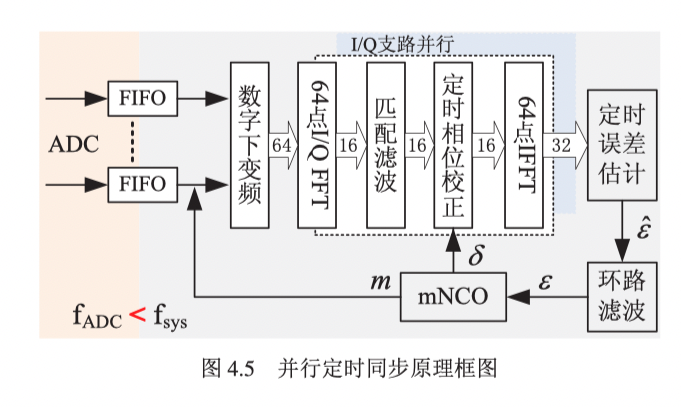
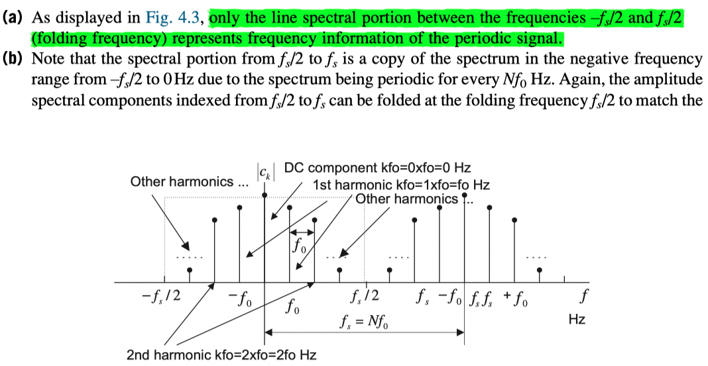
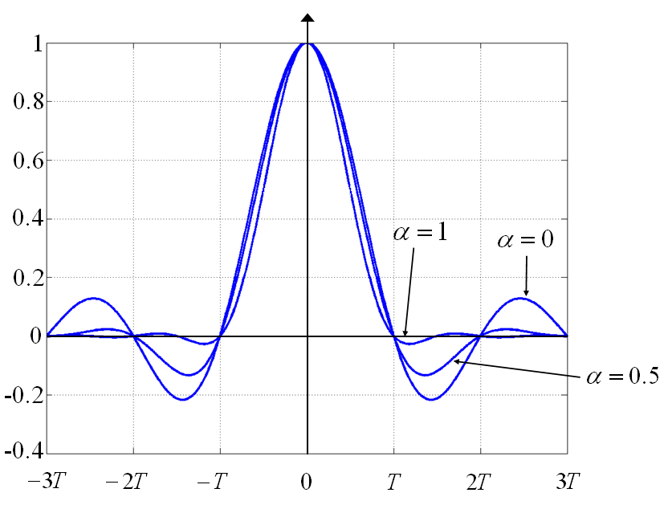
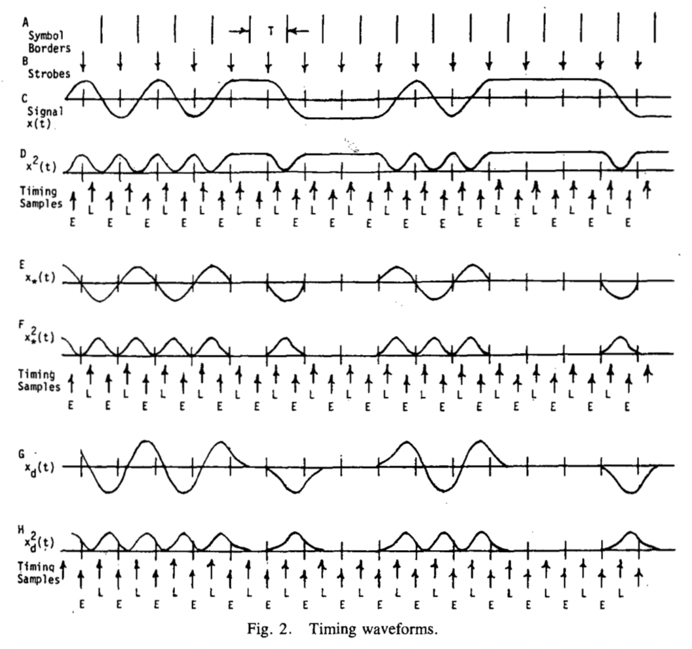
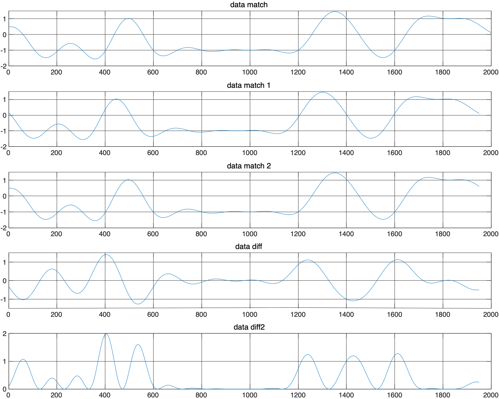

## Timing synchronization with frequency-domain matched filtering and the O&M algorithm

According to Lin Changxing's thesis, delay coefficients can be used during frequency-domain matched filtering to compensate for timing error. The implementation is shown in the block diagram below. First, an FFT is applied to the downconverted data. The result is multiplied pointwise by the FFT of the matched-filter coefficients, reproducing convolution in the time domain. The filtered data is then multiplied in the frequency domain by coefficients associated with the timing error calculated by the NCO, producing a time-domain shift. An IFFT gives the final matched-filtered and timing-synchronized data. This data enters the timing-error estimator, where the O&M algorithm produces the unbiased estimate $\hat{\varepsilon}$. That estimate, $\hat{\varepsilon}$, is passed through the loop filter, while the NCO performs overflow control on the loop-filter output $\varepsilon$.



### O&M timing-error estimation

Oerder and Meyr proposed the O&M algorithm in 1988. It requires at least fourfold oversampling, but produces an unbiased estimate of the true timing error. At high SNR, it is asymptotically equivalent to maximum-likelihood estimation. It is also insensitive to SNR and carrier-frequency offset and offers better performance than the Gardner algorithm. The main derivation follows.

Suppose the signal received after passing through the channel is

$$
\begin{equation}
    \begin{aligned}
    r(t) &=\sum_ {n=-\infty}^{\infty} a_ {n} g_ {T}(t-n T-\varepsilon(t) T)+n(t) \\
    &=u(t)+n(t) .
    \end{aligned}
\end{equation}
$$

Here, $a_ n$ is a complex signal. For QPSK, its values are $\pm 1, \pm i$, placing four points on the coordinate axes. $g_T(t)$ is the transmitted signal's unit impulse response, $T$ is the symbol duration, and $n(t)$ is channel noise, assumed here to be white Gaussian noise with power spectral density $N_0$. The timing error $\varepsilon(t)$ is unknown and varies slowly over time.

Because the timing error $\varepsilon$ changes slowly, a digital implementation can divide the signal into blocks. Within each block $\Delta_m$, we can assume $\varepsilon$ is constant and estimate it as $\hat{\varepsilon}$. This timing-error estimate needs to be combined with estimates from preceding intervals—that is, filtered—to obtain the best estimate $\bar{\varepsilon}$, which controls the detector's sampler.

Suppose the receiver impulse response is $g_R(t)$, so that the received signal is $\tilde{r}(t)=r(t) * g_{R}(t)$. With sampling rate $N/T$, the received samples are $\tilde{r}_ {k}=\tilde{r}(k T / N)$. Squaring the received sequence gives

$$
\begin{equation}
  x_{k}=\left|\sum_{n=-\infty}^{\infty} a_{n} g\left(\frac{k T}{N}-n T-\varepsilon T\right)+\tilde{n}\left(\frac{k T}{N}\right)\right|^{2}
\end{equation}
$$

where $g(t)=g_ {T}(t) * g_{R}(t)$. This expression represents the samples after the received signal has been filtered and squared. Its spectrum has a component at $1/T$.

Divide the squared sequence into blocks of duration $LT$, each containing $LN$ symbols, and calculate its complex Fourier-series component at the symbol rate:

$$
X_{m}=\sum_{k=m L N}^{(m+1) L N-1} x_{k} e^{-j 2 \pi k / N}
$$

Taking the normalized phase of this series gives $\hat{\varepsilon}_ m=-1 / 2 \pi \arg \left(X_{m}\right)$. The normalized phase $\hat{\varepsilon}_m$ is an unbiased estimate of the timing error $\varepsilon$. Refer to the original paper for the proof.

> Note that the $\arg()$ operator is not equivalent to $\arctan()$. The range of $\arctan()$ is $\left(-\frac{\pi}{2}, \frac{\pi}{2}\right)$, whereas $\arg()$ gives the phase angle of the current complex vector and has range $\left(-\pi, \pi\right)$.

**A question: why does the spectrum above have a component at $1/T$?**

Figure 4.3 in *Digital Signal Processing Fundamentals and Applications* provides a useful reference. A signal with symbol period $T$ has frequency $f_0$. If it is sampled at rate $f_s=Nf_0=N/T$, its spectrum should contain N values spaced by $f_0$ over the range from 0 to $fs$, or 0 to $Nf_0$. Thus, the expression above must have a component at $1/T$. This also explains why O&M requires more than twofold oversampling. With only twofold oversampling, there are N+1 spectral lines in the range from 0 to $f_s$, namely 0, 1/T, and 2/T. The Nyquist sampling requirement is not satisfied, so aliasing occurs at 1/T, making the acquired data inaccurate and affecting the subsequent decision.



### Properties of the O&M algorithm

O&M has the following properties:

- Requires at least fourfold oversampling.
- The estimated timing error $\hat{\varepsilon}$ is an unbiased estimate of the true timing error.
- Can be used in either feedforward or feedback structures.
- Insensitive to frequency offset.
- Insensitive to SNR.
- Its feedforward form is suitable for burst communications.

## The Gardner algorithm

> Reading notes on *A BPSK/QPSK Timing-Error Detector for Sampled Receivers*.

The basic Gardner expression is

$$
\begin{aligned}
u_{t}(r)=y_{I}(r-\frac{1}{2})[&\left.y_{I}(r)-y_{I}(r-1)\right] \\\\
&+y_{Q}(r-\frac{1}{2})\left[y_{Q}(r)-y_{Q}(r-1)\right]
\end{aligned}
$$

In $y_I(r)$, $r$ is the symbol index. It is convenient to denote the strobe values of the $r$th symbol- as $y_I(r)$ and $y_Q(r)$. At this point, I am not entirely sure whether "strobe" refers to a sampled value or an interpolated one. The values at the point between the two strobes are $y_{I}(r-\frac{1}{2})$ and $y_{Q}(r-\frac{1}{2})$. This is the Gardner formula for calculating the timing-error estimate $u_t(r)$ from the samples.

### Properties of the Gardner algorithm

Advantage:

- Requires only twofold oversampling.

Disadvantage:

- Requires 40%–100% excess bandwidth.

> Why is 40%–100% excess bandwidth needed?

Because an overly narrow bandwidth introduces self-noise.

Why does that happen, and where does the self-noise come from?



> Looking at the figure above, when $\alpha=1$—100% spectral expansion—the response is zero at 1.5T. At this point, samples $y_{I}(r-\frac{1}{2})$ and $y_{Q}(r-\frac{1}{2})$ are not at zero crossings. The calculated timing errors therefore appear as scattered points rather than zeros. Averaging resolves this, but looking only locally introduces self-noise, which grows as $\alpha$ decreases.

### Interpreting the Gardner timing-error formula

The expression looks simple and has many explanations. Direct explanations, however, tend to remain superficial and do not reveal how someone arrived at it. It seems better to work through Gardner's original derivation and try to recover the original line of thought. First, here is the paper's own explanation.

> A physical explanation can be ascribed. The detector samples the data stream midway between strobe locations in each of the $I$ and $Q$ channels. If there is a transition between symbols, the average midway value should be zero, in the absence of timing error. A timing error gives a nonzero sample whose magnitude depends upon the amount of error, but either slope is equally likely at the midway point so there is no direction information in the sample alone.

To sort out these different possibilities, the algorithm examines the two strobe values to either side of the midway sample. If there is no transition, the strobe values are the same, their difference is zero, and so the midway sample is rejected. (No timing information is available in the absence of a transition.)

If a transition is present, the strobe values will be different; the difference between them will provide slope information. The product of the slope information and the midway sample provides timing-error information.

Here is my own interpretation, written down so I do not forget it. The detector samples the midpoint between symbol strobes in the $I$ and $Q$ channels: $y(r-1/2)$ in the expression. A strobe roughly refers to the preferred symbol-sampling location. However, this paper predates Gardner's timing-recovery loop and discusses only timing-error detection. In that setting, a strobe should not immediately be understood as the optimal sampling point. It is an ordinary sample corresponding to one symbol; the corresponding sample of the adjacent symbol is the next strobe. For example, with fourfold oversampling, suppose the second sample of the current symbol is the strobe $y(r-1)$. The adjacent strobe is four samples later, namely $y(r)$. "Midway" simply means the midpoint between the two strobes of the received waveform. Again taking fourfold oversampling and sample indices 1/2/3/4/5/6/7/8: if sample 2 is the first strobe, $y(r-1)$, sample 4 is the midpoint, $y(r-1/2)$, and sample 6 is the second strobe, $y(r)$. In a Gardner loop with feedback, by contrast, the strobe is the interpolated optimal sampling point; otherwise, repeatedly using the original acquired samples would never let the timing error converge. If there is a transition between the two symbols, the mean midpoint value should be zero when there is no timing error. A timing error makes the midpoint sample nonzero, with its magnitude depending on the size of the error. The midpoint term alone, however, does not indicate direction: whether timing is early or late.

To recover that direction, the algorithm compares the symbol samples on either side of the midpoint, using $y(r)-y(r-1)$. If there is no transition, the two symbol samples should be equal. Their difference is zero, eliminating the midpoint term. No timing information is available in this case: without a transition, timing error cannot be obtained.

If there is a transition, the symbol samples differ, and that difference provides slope information. Multiplying the slope information by the midpoint value provides timing-error information.

### Deriving the Gardner timing-error formula



First, consider the figure:

- Trace A marks the symbol boundaries. Each symbol lasts $T$.
- Trace B marks the optimal sampling points, at the centers of the symbol intervals.
- Trace C is a baseband signal after pulse shaping and matched filtering. It satisfies the Nyquist criterion, is bandlimited, and uses 100% roll-off.

How can a clock waveform be recovered from the data stream? One established method is to pass the signal through a simple rectifier. A square-law rectifier simply squares the data. As shown in trace D, the squared signal has several advantages:

- Its noise performance is nearly optimal, especially at low SNR.
- A pure sine-wave input produces an output sine wave at twice the frequency.
- Squaring is the only nonlinear operation in the method, and it is mathematically tractable.
- The square-law rectifier can recover a clock waveform independently of carrier phase in the I and Q branches, which is important during acquisition.

Trace D can be used to produce a protoclock. More specifically, start with a pure sinusoidal waveform whose period corresponds to the symbol rate, interrupt it where the data does not transition, and retain it where transitions occur. Passing this protoclock through a narrowband filter or a phase-locked loop recovers the desired clock line and removes other interference. This is the analog clock-recovery approach.

On closer inspection, the method could also be used in a digital system, but it is inconvenient. The computational cost is relatively high, and two samples are not quite enough: the sine-wave period equals the symbol period, and only two samples per sine-wave cycle do not satisfy the sampling theorem. The approach therefore needs modification for digital use. **But our goal is to calculate timing error, not to reconstruct the protoclock. Fundamentally, the protoclock does not need to be reconstructed.**

Traces E and F correspond to a prefilter method. Gardner does not use this method, so I will not discuss it further here. It was proposed to improve on the method associated with trace D; references are available in the literature.

Now consider the delay-and-difference method used by Gardner.

Let the differencer perform

$$
x_{d}(t)=x(t)-x\left(t-t_{d}\right)
$$

where $t_d$ is a predetermined delay. If $t_d=T/2$, the average delay of $x_d$ is $T/4$: the time offset between the sampling instant and the instant represented by the calculated timing error. I do not yet fully understand why the average delay is $T/4$, although that does not prevent the derivation from proceeding. My current understanding is that traces D and E are aligned in time with the original signal, while the waveform calculated using this expression differs by $T/4$.

Set $t_d=T/2$. Applying the delay-and-difference operation to trace C gives trace G. It resembles trace E, but G is not a particular fixed waveform, whereas E is sinusoidal. G has almost the same periodic behavior as E. I do not yet have a complete explanation for choosing $t_d=T/2$ rather than another value. My current thought is that separating the samples by half a period gives a structure comparable to trace D: when one is on a rising edge, the other is on a falling edge. Taking their difference at spacing $t_d=T/2$ should therefore reflect transitions in the signal. In simulations, however, there does not seem to be much difference over the range from $t_d=T/4$ to $t_d=3T/4$.

Trace G oscillates only when the original signal transitions; otherwise, it returns to zero. Squaring G gives trace H, which also forms a protoclock. Timing-error information can then be obtained from the difference between $E(r)$ and $L(r)$:

$$
u_{t}(r)=E(r)-L(r-1)
$$

Here, $E(r)$ is the sample of symbol $r$, while $L(r-1)$ is the sample of symbol $r-1$. $E$ corresponds to the early sample and $L$ to the late sample.

The next step is to simplify this function. First,

$$
x_{d}(t)=x(t)-x(t-T / 2)
$$

Squaring gives

$$
x_{d}^{2}(t)=x^{2}(t)+x^{2}(t-T / 2)-2 x(t) x(t-T / 2)
$$

Sampling at $t=r T+\tau$ and $r T+\tau-T / 2$ gives

$$
\begin{aligned}
E(r)=& x_{d}^{2}(r T+\tau) \\\\
=& x^{2}(\tau+r T)+x^{2}(\tau+(r-1 / 2) T) \\\\
&-2 x(\tau+r T) x(\tau+(r-1 / 2) T)
\end{aligned}
$$

and

$$
\begin{aligned}
&L(r-1)=x^{2}(\tau+(r-1 / 2) T)+x^{2}(\tau+(r-1) T) \\\\
&-2 x(\tau+(r-1 / 2) T) x(\tau+(r-1) T)
\end{aligned}
$$

Let

$$
u_{t}(r)=L(r-1)-E(r)
$$

Simplifying the expression gives

$$
\begin{aligned}
&u_{t}(r)=x^{2}(\tau+(r-1) T)-x^{2}(\tau+r T) \\\\
&+2 x(\tau+(r-1 / 2) T)\{x(\tau+r T)-x(\tau+(r-1) T)\}
\end{aligned}
$$

Could this already serve as the timing-error term? Yes: it contains timing-error information. But it can be simplified further. Taking its mean gives

$$
\begin{aligned}
&U_{t}(\tau)=\operatorname{Avg}\lbrace x^{2}(\tau+(r-1) T)\rbrace-\operatorname{Avg}\lbrace x^{2}(\tau+r T)\rbrace \\\\
&+2 \operatorname{Avg}\{x(\tau+(r-1 / 2) T)(x(\tau+r T)-x(\tau+(r-1) T))\}
\end{aligned}
$$

The first and second terms are identical because they are delayed versions of the same cyclostationary random signal, so they cancel. The presence of these two $x^2(\cdot)$ terms does not affect the mean of the useful output signal. The remaining term can be written as

$$
\begin{aligned}
u_{t}(r) &=x(\tau+(r-1 / 2) T)\{x(\tau+r T)-x(\tau+(r-1) T)\} \\\\
&=x(r-1 / 2)\{x(r)-x(r-1)\}
\end{aligned}
$$

This is the simplified Gardner timing-error detection formula.

Next, let's write a simulation:

```MATLAB
clc; clear; close all;

rand('seed', 1);
data = 2 * randi([0 1], 1, 20) - 1;
% data = 2 * [1 0 1 0 1 1 0 0 0 1 0 1 1 1 1 0] - 1;
span = 16;
sps = 100;
rrc = rcosdesign(1, span, sps);

data_shape = conv(upsample(data, sps), rrc, 'same');
data_match = conv(data_shape, rrc, 'same');
data_Diff = data_match(floor(sps/2)+1:end) - data_match(1:end-floor(sps/2));
data_Diff2 = data_Diff .^ 2;

figure;
subplot(5, 1, 1);
plot(data_match);
title('data match');
grid on;
subplot(5, 1, 2);
plot(data_match(floor(sps/2)+1:end));
title('data match 1');
grid on;
subplot(5, 1, 3);
plot(data_match(1:end-floor(sps/2)));
title('data match 2');
grid on;
subplot(5, 1, 4);
plot(data_Diff);
title('data diff');
grid on;
subplot(5, 1, 5);
plot(data_Diff2);
title('data diff2');
grid on;

```


The last two plots above correspond to traces G and H, using a roll-off factor of 1. Directly sampling $L$ and $E$ and taking their difference is equivalent to evaluating the original signal according to $x(r-1 / 2)\{x(r)-x(r-1)\}$.

> Since the code is already written, let's change the pulse-shaping filter's $\alpha$ and see what self-noise actually looks like.
Changing the roll-off factor directly to 0.1 gives the following result:



> The smaller roll-off factor clearly makes things much worse, introducing substantial self-noise.

### Why is the Gardner algorithm unaffected by frequency offset?

First, suppose we have a continuous-time complex signal after filtering:

$$
w(t)=\{a(t)+j b(t)\} e^{j \Delta \theta}
$$

Separating it into real and imaginary parts gives

$$
x_{R}(t)=a(t) \cos \Delta \theta-b(t) \sin \Delta \theta
$$

$$
x_{I}(t)=a(t) \sin \Delta \theta+b(t) \cos \Delta \theta
$$

Here, $\Delta \theta$ is the carrier-phase error, treated as random in this discussion. The timing-error estimation algorithm is

$$
\begin{aligned}
u_{t}(t)&=x_{1}(t-T / 2)\left[x_{1}(t)-x_{1}(t-T)\right] \\\\
&+x_{2}(t-T / 2)\left[x_{2}(t)-x_{2}(t-T)\right]
\end{aligned}
$$

Expanding it gives

$$
\begin{aligned}
u_t(t)=&\left(a(t-\frac{T}{2})\cos(\Delta\theta)-b(t-\frac{T}{2})\sin(\Delta\theta)\right)\cdot \\\\
&\left[a(t)\cos(\Delta\theta)-b(t)\sin(\Delta\theta)-a(t-T)\cos(\Delta\theta)+b(t-T)\sin(\Delta\theta)\right] + \\\\
&\left(a(t-\frac{T}{2})\sin(\Delta\theta)+b(t-\frac{T}{2})\cos(\Delta\theta)\right)\cdot \\\\
&\left[a(t)\sin(\Delta\theta)+b(t)\cos(\Delta\theta)-a(t-T)\sin(\Delta\theta)-b(t-T)\cos(\Delta\theta)\right]\\\\
&=a(t-\frac{T}{2})\left[a(t)-a(t-T)\right] + b(t-\frac{T}{2})\left[b(t)-b(t-T)\right]
\end{aligned}
$$

The simplified expression shows that carrier-frequency offset does not affect the timing error estimated by Gardner's algorithm. Gardner can therefore be used before carrier recovery.
